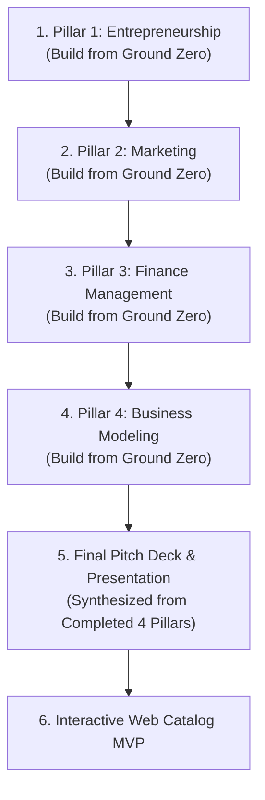

# Cheapify — Strategic Roadmap

High-level status and milestones across the 4 GIZ Incubation Program pillars and platform deliverables.

---

## Pillar Status Overview

| Pillar / Component | Lead Location | Status | Execution Focus |
| :--- | :--- | :---: | :--- |
| **1. Entrepreneurship** | [`entrepreneurship/`](../entrepreneurship/) | Completed | Built from ground zero: Problem & Value (01), Market Sizing & Evidences (02), Dual Personas (03), Competitive Matrix (04), Trilingual Validation Survey (05). |
| **2. Marketing** | `marketing/` | In Progress | GTM Strategy, Brand Identity + HTML Brandbook, and two-phase social content plans complete. Open: Kurdish native proofread, waitlist page + social profiles, then pillar sign-off. |
| **3. Finance** | `finance/` | In Progress | 01 operational budget, 02 unit economics, 03 cash flow & break-even, 04 GIZ funding request ($6,150 / $3,950 / $2,610, rebuilt per ADR-015) complete. Verified: courier quote, KRI registration fees, FIB/Qi fees, CBI exchange rate. Open: print quotes, lawyer/accountant quote, ad CPM, courier signature. |
| **4. Business Modeling** | `business-modeling/` | Completed | Built from ground zero: 01 9-block Business Model Canvas, 02 Core SOPs (Onboarding, 3PL Order Flow, Returns), 03 Operational Risk Matrix (17 risks scored, R1 traction top-ranked). |
| **Final Pitch Deck & Showcase** | `presentation/` | In Progress | All 4 pillars built — deck construction green-lit Oct 21, 2026. **Hard constraint: under 6 minutes total runtime** (slide count flexible). Awards are ranked (1st>2nd>3rd) — pitch must win on merit, not just qualify. Template: GIZ/CAPA header + footer only; archived decks' styling not reused. |
| **Technical Web MVP** | `mvp/` or `app/` | Queued | Interactive Web Catalog MVP demonstrating Single-SKU comparison and WhatsApp order flow. |

---

## Strategic Build Sequence

