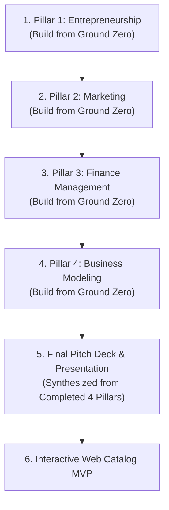

# Cheapify — Strategic Roadmap

High-level status and milestones across the 4 GIZ Incubation Program pillars and platform deliverables.

---

## Pillar Status Overview

| Pillar / Component | Lead Location | Status | Execution Focus |
| :--- | :--- | :---: | :--- |
| **1. Entrepreneurship** | [`entrepreneurship/`](file:///media/shakerbr/workland/workspace/git/my-private-repos/cheapify/entrepreneurship/) | 🟡 In Progress | Building from ground zero: Problem, Solution, Value, Market Sizing (TAM/SAM/SOM), Dual Personas, Competitive Matrix, Validation Survey. |
| **2. Marketing** | `marketing/` | ⚪ Queued | Building from ground zero: Two-Sided GTM Strategy (Shopper & Merchant), Brand Identity Reference, 30-Day Content Plan. |
| **3. Finance Management** | `finance-management/` | ⚪ Queued | Building from ground zero: Itemized 6-Month Pilot Budget, $2,200 GIZ Grant model, 12-Month P&L, Break-Even sensitivity. |
| **4. Business Modeling** | `business-modeling/` | ⚪ Queued | Building from ground zero: 9-Block Business Model Canvas, 3 Core SOPs (Onboarding, 3PL Order Flow, Returns), Risk Matrix. |
| **Final Pitch Deck & Showcase**| `presentation/` | ⏳ Awaiting Pillars 1–4 | To be constructed strictly AFTER all 4 pillars are fully built from ground zero. (Archived decks are partial non-final references only). |
| **Technical Web MVP** | `mvp/` or `app/` | ⚪ Queued | Interactive Web Catalog MVP demonstrating Single-SKU comparison and WhatsApp order flow. |

---

## Strategic Build Sequence

