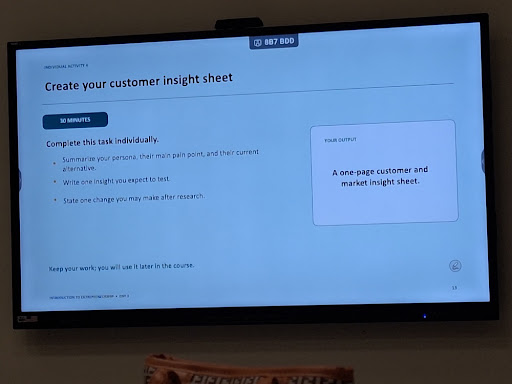

> From: https://gemini.google.com/app/80adf94c35573bad

# you asked

message time: 2026-09-14 12:11:25

Based on this

---

# gemini response

### Customer & Market Insight Sheet: Cheapify

---

#### 1. Persona Summary, Main Pain Point & Current Alternative

*   **Customer Persona:**
    *   **Demographics:** Young adult online shoppers (university students and tech-savvy consumers in urban hubs like Duhok and Erbil) who frequently purchase gadgets, electronics, and accessories.
    *   **Behavior:** Regularly buys online, compares options across social platforms, and pays mostly with cash on delivery (COD) or local digital wallets (FastPay, Qi Card).
*   **Main Pain Point:**
    *   **Price Discrepancy & Lack of Trust:** The exact same product is sold at wildly inconsistent, arbitrary prices across disconnected pages. Shoppers waste hours messaging sellers just to check prices and stock, leaving them uncertain about who to trust or whether they are overpaying.
*   **Current Alternative:**
    *   Manually browsing dozens of individual Instagram and Facebook shops, sending direct messages to multiple accounts to ask for prices and availability, or buying directly from physical retail stores without knowing if a better deal exists nearby.

---

#### 2. Insight Expected to Test

*   **Core Hypothesis to Validate:**
    *   Shoppers prioritize **transparent, side-by-side price comparison** from verified sellers over remaining loyal to their usual social media shop, and they will complete a purchase on a centralized platform if familiar local payment and delivery methods are supported.
*   **Validation Question:**
    *   Will seeing a guaranteed lower price from another verified local seller motivate a buyer to switch from ordering via social media DMs to checking out directly through a unified web/app catalog?

---

#### 3. Change We May Make After Research

*   **Potential Pivot / Adjustment:**
    *   If field interviews reveal that buyers still prefer chatting directly with sellers to confirm device condition, warranty, or delivery timing before paying, we will pivot from a purely automated checkout to a **hybrid model**—integrating a 1-click WhatsApp order confirmation directly with the seller while preserving the centralized price-comparison engine.

---

# you asked

message time: 2026-09-14 12:23:28

They want only the first ponit.

---

# gemini response

### Persona Summary, Main Pain Point & Current Alternative

*   **Customer Persona:**  
    Everyday online shoppers and tech-savvy young adults in Iraq who regularly buy products (such as gadgets, tech accessories, and electronics) online.

*   **Main Pain Point:**  
    **Price Inconsistency & Disorganization:** For the exact same item, prices change arbitrarily across scattered pages, listings are messy, and buyers struggle to know who to trust or whether they are overpaying.

*   **Current Alternative:**  
    Manually scrolling through dozens of disconnected Instagram and Facebook pages, messaging multiple sellers via DM to ask for prices, or visiting physical shops without knowing if a better deal exists nearby.

---

# you asked

message time: 2026-09-14 12:23:48

Why tech savvy??

---

# gemini response

You don't need to use "tech-savvy" at all. 

It was only included earlier because early versions of the project focused heavily on phones, electronics, and accessories, where university students and tech-interested buyers are usually the early adopters. 

Since Cheapify is built for anyone buying everyday products online, you can simplify it so it feels completely natural and accurate:

*   **Customer Persona:**  
    Everyday shoppers and university students in Iraq who actively buy products through Instagram, Facebook, and local online pages.

*   **Main Pain Point:**  
    **Price Inconsistency & Uncertainty:** The exact same item is sold at wildly different, random prices across scattered pages, making it hard to know who to trust or whether they are overpaying.

*   **Current Alternative:**  
    Manually scrolling through multiple social media accounts, messaging sellers one by one via DM to ask for prices, or buying locally without knowing if a better deal exists nearby.

---

# you asked

message time: 2026-09-14 12:25:33

Okay but more about the persona. 

He want us to write it in a way, like defining a person, for example
someone(name)
occupation
specialization
Age
Rich or poor?
Have family or not? 
male or female? 

And stuff like that about it

---

# gemini response

### Customer Persona: The Smart Deal-Seeker

*   **Name:** Ahmad
*   **Age:** 23 years old
*   **Gender:** Male
*   **Location:** Duhok (living with his family in an apartment/house)
*   **Occupation / Specialization:** Final-year university student (majoring in Business Administration) who works part-time as an office assistant
*   **Financial Status:** Moderate / Middle-class (budget-conscious; manages limited monthly spending money from his part-time wage and family support)
*   **Shopping Behavior:** Active on social media (Instagram, Facebook, and TikTok); frequently buys daily items, tech accessories, study gear, and personal products online using Cash on Delivery (COD) or FastPay

---

### Main Pain Point
*   **Price Inconsistency & Waste of Time:** Ahmad often sees the exact same item priced with random 5,000 to 15,000 IQD differences across various Instagram pages. He has to spend hours messaging multiple pages via DM just to ask "How much?", waiting hours for replies, and still worrying if he is getting ripped off or overpaying.

---

### Current Alternative
*   **Manual DM Inquiries:** Scrolling through 4–6 separate Instagram/Facebook shops, DMing each seller to request prices, or walking through local commercial bazaars hoping he stumbles upon a fair deal without knowing market rates.