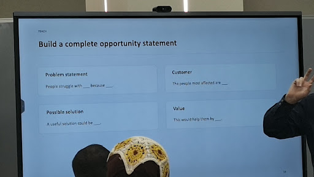
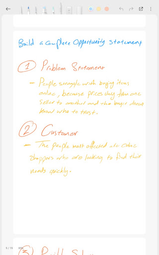
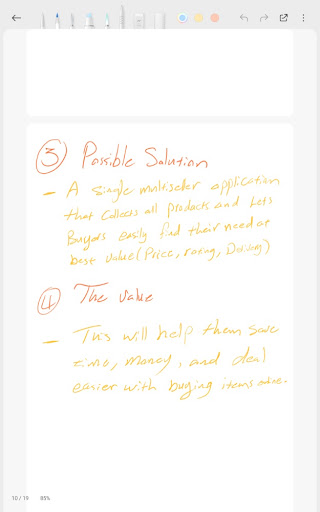

> From: https://gemini.google.com/app/22c1c12f78f111a4

# you asked

message time: 2026-09-13 12:50:34

Based on this

---

# gemini response

Based on the template shown on the screen, here is the complete opportunity statement structured for **Cheapify**:

---

### Opportunity Statement Breakdown

* **Problem statement:**
  > "People struggle with **finding fair and consistent prices when shopping online** because **products are scattered across unorganized social media pages with arbitrary pricing and duplicate listings.**"

* **Customer:**
  > "The people most affected are **everyday online shoppers looking for the best deals, as well as local retail shop owners who lack an affordable way to sell online.**"

* **Possible solution:**
  > "A useful solution could be **a centralized multi-seller marketplace that automatically groups identical products together to show side-by-side price comparisons from verified local shops.**"

* **Value:**
  > "This would help them by **saving buyers time and money so they feel confident they are getting the best deal, while giving local sellers an easy digital channel to reach more customers without expensive setup fees.**"

---

### Complete Combined Statement

> "People struggle with **finding fair and consistent prices when shopping online** because **products are scattered across unorganized social media pages with arbitrary pricing**. The people most affected are **everyday online shoppers and small local retail shop owners**. A useful solution could be **a unified marketplace that automatically groups identical items to compare verified local seller prices side by side**. This would help them by **saving shoppers money and search time, while giving local shops steady digital sales without high fees or technical complexity.**"

---

# you asked

message time: 2026-09-13 12:54:15

---

# gemini response

Here is a cleaned-up, professional transcription of your handwritten notes, followed by the complete, combined opportunity statement:

---

### Cleaned & Polished Points

**1. Problem Statement**
* People struggle with buying items online because prices vary widely from one seller to another, and buyers do not know who to trust.

**2. Customer**
* The people most affected are online shoppers who are looking to find what they need quickly and reliably.

**3. Possible Solution**
* A single multi-seller application that brings together all products in one place, allowing buyers to easily find what they need at the best overall value (comparing price, seller ratings, and delivery options).

**4. The Value**
* This will help them save time and money, reducing the stress and friction of buying items online.

---

### Complete Opportunity Statement

> "People struggle with **buying items online** because **prices vary widely from one seller to another and buyers don't know who to trust**. The people most affected are **online shoppers looking to find their needs quickly**. A useful solution could be **a single multi-seller application that collects all products in one place and lets buyers easily find what they need at the best value based on price, rating, and delivery**. This would help them by **saving them time and money while making online shopping far easier and more dependable**."

---

# you asked

message time: 2026-09-13 13:04:20

The first answers  you gave me sounded better. 
Can you make a good mix of both? 
Use simple english

---

# gemini response

Here is a clean mix of both versions using simple, direct English and matching the classroom template:

---

### Opportunity Statement Breakdown

* **Problem statement:**
  > "People struggle with **buying items online** because **prices change wildly from one seller to another across social media, and buyers don't know who to trust.**"

* **Customer:**
  > "The people most affected are **online shoppers looking for honest deals fast, as well as local shop owners who need an easy way to sell online.**"

* **Possible solution:**
  > "A useful solution could be **a single multi-seller app that gathers local products into one place, automatically compares prices side by side, and highlights top ratings and delivery options.**"

* **Value:**
  > "This would help them by **saving buyers real time and money so they feel smart and confident with their purchase, while helping local sellers get steady orders without high fees.**"

---

### Complete Combined Statement

> "People struggle with **buying items online** because **prices vary wildly across social media pages and buyers don't know who to trust.** The people most affected are **everyday online shoppers who want to find good deals quickly, plus local retail shop owners.** A useful solution could be **a single multi-seller app that puts all products under one roof, letting buyers compare verified seller prices, ratings, and delivery side by side.** This would help them by **saving buyers time and money so they feel smart and safe shopping online, while giving local shops an easy way to grow.**"

---

# you asked

message time: 2026-09-13 13:05:58

I think this "while helping local sellers get steady orders without high fees." isn't true, cause here in my area, local buyers rarely even think of building a store online. even if they did want to sell online, they would probably use social media pages.

---

# gemini response

That is a great observation, and grounding your statement in how people actually do business locally makes your project much stronger and more realistic. 

In your area, you aren't trying to convince physical shop owners to build websites—you are helping **existing social media sellers (on Instagram and Facebook)** run their sales without the daily mess of answering endless DMs, manually checking competitor prices, or coordinating chaotic deliveries.

Here is an updated, realistic version tailored completely around that:

---

### Opportunity Statement Breakdown

* **Problem statement:**
  > "People struggle with **buying items online** because **prices vary wildly across scattered social media pages, listings are messy, and buyers don't know who to trust.**"

* **Customer:**
  > "The people most affected are **everyday online shoppers looking for fair deals fast, as well as local social media sellers who spend hours answering repetitive messages and coordinating deliveries manually.**"

* **Possible solution:**
  > "A useful solution could be **a single multi-seller app that gathers local products in one place, automatically compares prices side by side, and gives sellers a simple way to take organized orders.**"

* **Value:**
  > "This would help them by **saving buyers time and money so they feel confident and safe, while freeing sellers from messy chat orders and helping them reach more customers easily.**"

---

### Complete Combined Statement

> "People struggle with **buying items online** because **prices vary wildly across scattered social media pages and buyers don't know who to trust.** The people most affected are **everyday online shoppers looking for fair deals fast, plus local sellers running pages on Instagram and Facebook.** A useful solution could be **a single multi-seller app that puts local products under one roof, letting buyers compare prices side by side and order directly.** This would help them by **saving buyers time and money so they feel confident in their purchases, while helping page sellers manage orders smoothly without the headache of endless chat messages.**"