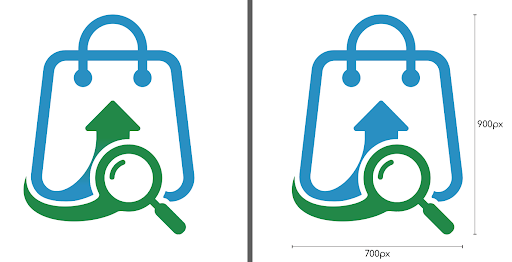

> From: https://gemini.google.com/app/d30a5a9d2912f4b3

# you asked

message time: 2026-10-03 16:31:28

Which logo is better? With or without gradient?

---

# gemini response

For a smart multi-seller marketplace app like Cheapify, a logo **without a gradient (flat design)** is the stronger choice. While gradients can add a sense of depth, a flat logo aligns much better with your specific platform's utility and brand goals:

*   **Visual Transparency:** Cheapify’s brand triad is built on being "Transparent," "Smart," and "Reliable," emphasizing "Live side-by-side pricing" and "Zero hidden fees". Flat, solid colors visually reinforce this straightforward, no-nonsense promise, whereas gradients can sometimes feel overly styled or distracting.
*   **Digital Scalability:** Because your primary touchpoints are an app, a Web Catalog, and WhatsApp ordering, the logo will frequently be viewed at very small sizes. A flat design ensures the three core elements of your visual mark (the blue market hub container, the green growth arrow, and the discovery magnifier) remain crisp and immediately recognizable on mobile screens. 
*   **Physical Reproduction:** As you roll out merchant call-outs and local seller spotlights, you may eventually print physical collateral like "Verified by Cheapify" window stickers or packaging for your local delivery integration. Solid Boston Blue and Jade Green are significantly easier, cheaper, and more consistent to print than gradients.

Sticking to the flat design keeps the focus exactly where it should be—on the smart deal discovery. Have you started testing how the flat icon looks on a mobile home screen?