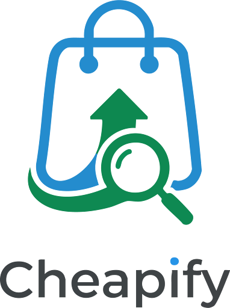
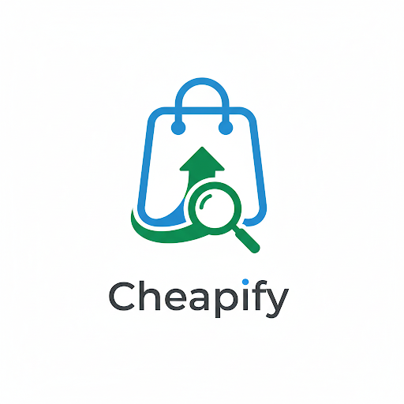

> From: https://gemini.google.com/app/bb856d29de5bcb14

# you asked

message time: 2026-09-21 11:01:57

Does the logo suit my business or should I change it before working further on my project?

---

# gemini response

The logo designs are a very strong starting point that accurately reflect the brand identity you have built in your workbook, though there is one symbolic element you might want to reconsider before a final public launch. 

Here is a breakdown of how the designs suit your business:

*   **Strong Brand Alignment:** The visual elements in "Cheapify.png" and "Gemini_Generated_Image_5j6ptq5j6ptq5j6p.png" directly execute your workbook's vision of a modern blue shopping bag featuring a green magnifying glass and an arrow. 
*   **Effective Color Psychology:** The designs correctly utilize your brand colors of Boston Blue, Azure Blue, and Jade Green. These colors naturally support your goal of appearing "Transparent, Smart, Reliable" to your users.
*   **Clear Value Proposition:** The magnifying glass over the shopping bag is a highly effective way to communicate your core offering: algorithmic side-by-side price comparisons and smart deal discovery.
*   **Mobile-Ready Formats:** "Cheapify-2.png" offers a clean, scalable version of the icon without text, while "Cheapify-2-2.png" demonstrates that the logo adapts perfectly into a dark-mode app icon format. Because your target audience is 18–35-year-olds shopping via mobile platforms like WhatsApp, TikTok, and Instagram, having a highly readable app icon is essential.

**The One Element to Reconsider:**
The only structural critique is the **upward-pointing arrow**. Your workbook states this arrow represents smart deal discovery and price savings. However, in retail and finance, an upward arrow usually symbolizes *rising* prices or inflation. Since your platform is named Cheapify and your main goal is to help budget-conscious buyers—like your target persona Ahmad—avoid overpaying and find the lowest price, an upward arrow visually contradicts your promise. 

You do not necessarily need to halt your project to change this immediately. The current logo is professional and fully capable of serving as your Minimum Viable Product (MVP) branding as you test your web catalog with your first 5–10 pilot sellers. When you have the time to iterate, simply flipping the arrow to point downward (symbolizing dropping prices) or changing it to a checkmark (symbolizing verified sellers and the "right" choice) would perfectly align the psychology of the logo with your business model.