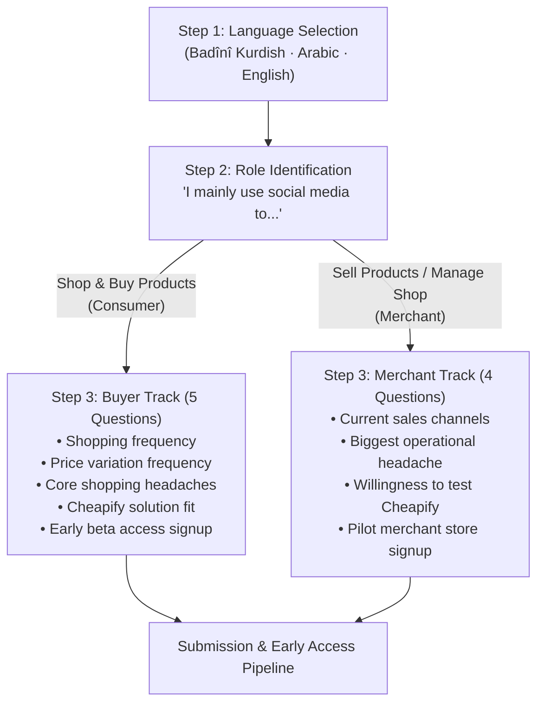

# Cheapify — Trilingual Market Validation Survey & Field Research Framework

**Pillar:** Entrepreneurship (Pillar 1)  
**Status:** Live Active Research (Responses Currently Being Collected)  
**Target Audiences:** Dual Cohort (Shoppers & Retail Merchants)  
**Languages Supported:** Kurdish (Badînî), Arabic, English  

---

## 1. Executive Summary & Survey Objectives

To ground Cheapify's business model in empirical market facts rather than theoretical assumptions, we deployed a **live, trilingual market validation survey**. The survey is actively distributed across the Duhok pilot ecosystem and the Kurdistan Region.

### Core Validation Goals:
1. **Empirically Validate the Problem:** Measure the real-world prevalence of **arbitrary price variation** and quantify consumer frustration with the **"Interrogation Tax"** ("DM for price").
2. **Empirically Validate the Merchant Pain:** Quantify merchant hours wasted on repetitive chat inquiries and assess their willingness to adopt a structured catalog dashboard.
3. **Test Solution-Market Fit:** Measure consumer intent to use a Single-SKU side-by-side comparison marketplace.
4. **Seed the Pilot Pipeline (Lead Capture):** Convert survey respondents directly into our **first 100 beta shoppers** and identify candidate retail shops for our **5 to 10 pilot merchant partners** in Duhok.

---

## 2. Hypothesis Testing Matrix

Every question in the survey directly tests a core hypothesis of the Cheapify business model:

| Target Cohort | Tested Hypothesis | Survey Question Focus | Validation Threshold |
| :--- | :--- | :--- | :---: |
| **Shoppers** | **H1 (Price Variation):** Identical products sell at wildly conflicting prices across local social media pages. | Frequency of noticing large price gaps for the exact same item. | **>70%** report frequent or constant gaps. |
| **Shoppers** | **H2 (Interrogation Tax):** "DM for price" and lack of listed colors/specs are the top shopping annoyances. | Ranking biggest online shopping headaches (unlisted prices, chat lag). | **>65%** rank chat delays & hidden prices #1. |
| **Shoppers** | **H3 (Single-SKU Demand):** Shoppers want an app that displays all competing verified sellers side-by-side. | Willingness to switch to a side-by-side comparison app. | **>75%** express positive adoption intent. |
| **Merchants** | **H4 (Chat Exhaustion):** Sellers spend excessive time answering repetitive questions from non-serious buyers. | Primary operational bottlenecks in online retail. | **>60%** cite repetitive "Price?" DMs as top pain. |
| **Merchants** | **H5 (Turnkey Adoption):** Sellers want organized orders and price alerts without costly custom software. | Willingness to test a zero-upfront-cost catalog platform. | **>50%** express interest in pilot participation. |

---

## 3. Survey Architecture & Smart Branching Logic

The survey utilizes dynamic branch logic to deliver a frictionless experience across 3 languages and 2 user personas:



### Frictionless Distribution Setup:
* **No Forced Sign-In:** Google account login requirements are toggled **OFF**, allowing respondents to complete the survey seamlessly inside in-app browsers (Instagram, Facebook, WhatsApp, Telegram) without encountering drop-off login screens.
* **Compact Execution:** Under 2 minutes to complete (5 questions for buyers; 4 questions for merchants).

---

## 4. The Trilingual Survey Instruments

### 4.1 Section 1: Language Selection & Role Branching

#### Language Selection
* **English:** Choose your language
* **Kurdish (Badînî):** زمانێ خۆ هەلبژێرە
* **Arabic:** اختر لغتك
* **Options:**
  1. English
  2. کوردی (Badînî)
  3. العربية

---

#### Role Identification (Routing Trigger)
* **English:** I mainly use social media/apps to:
  * Option A: Shop & buy products *(Routes to Buyer Track)*
  * Option B: Sell products / Manage a shop *(Routes to Merchant Track)*
* **Kurdish (Badînî):** ئەز ب شێوەیەکێ سەرەکی سۆشیال میدیایێ بکار دئینم بۆ:
  * هەلبژارتنا ١: کڕینا کەلوپەلان (کڕیار) *(دچیتە پشکا کڕیاران)*
  * هەلبژارتنا ٢: فرۆتنا کەلوپەلان / خودان جهـ (فرۆشیار) *(دچیتە پشکا فرۆشیاران)*
* **Arabic:** أستخدم وسائل التواصل الاجتماعي والتطبيقات بشكل أساسي من أجل:
  * خيار أ: تسوق وشراء المنتجات (مشتري) *(ينتقل إلى استطلاع المشترين)*
  * خيار ب: بيع المنتجات وإدارة متجر (تاجر / بائع) *(ينتقل إلى استطلاع التجار)*

---

### 4.2 Track A: Consumer / Buyer Questionnaire

#### Question 1: Online Shopping Frequency (Behavioral Baseline)
* **Purpose:** Gauges market activity and transaction frequency.
* **Trilingual Formulation:**
  * **EN:** How often do you shop online from Facebook, Instagram, or local apps?
  * **KU (Badînî):** چەند جار ئەنلاین یاخوود ژ پەیجێن فەیسبووک و ئینستاگرامی تشتان دکڕی؟
  * **AR:** كم مرة تتسوق عبر الإنترنت من فيسبوك، إنستغرام أو التطبيقات المحلية؟
* **Options:**
  1. Weekly | حەفتییانە | أسبوعياً
  2. A few times a month | مەهانە چەند جاران | عدة مرات في الشهر
  3. Rarely | دەگمەن | نادراً
  4. Never | چ جاران | أبداً

---

#### Question 2: Price Variation Detection (Foundational Problem Validation)
* **Purpose:** Directly validates Cheapify's primary spark—arbitrary price disparities across competing sellers.
* **Trilingual Formulation:**
  * **EN:** When searching for a product, do you notice big price differences for the exact same item across pages?
  * **KU (Badînî):** دەمێ ل بەرهەمەکی دگەڕی، ئایا جیاوازییا بهایان د ناڤبەرا پەیجان دا بۆ هەمان کەلوپەل دبینى؟
  * **AR:** عند البحث عن منتج معين، هل تلاحظ فارقاً كبيراً في الأسعار لنفس المنتج تماماً بين الصفحات؟
* **Options:**
  1. Yes, constantly (large gaps) | بەڵێ، بەردەوام (جیاوازییا مەزن یا هەی) | نعم، دائماً وبفارق كبير
  2. Sometimes | هندەک جاران | أحياناً
  3. Rarely / Never | کێم جار | نادراً / لم ألاحظ
  4. No, prices are similar | نەخێر، بهایێن وان نێزیکی ئێکن | لا، الأسعار متقاربة

---

#### Question 3: Shopping Headaches & The "Interrogation Tax" (Pain Point Ranking)
* **Purpose:** Identifies the emotional drivers of buyer fatigue in social commerce.
* **Trilingual Formulation:**
  * **EN:** What annoys you the most when shopping online locally? *(Select top 2)*
  * **KU (Badînî):** چ تشت زێدەتر تە بێزار دکەت دەمێ ب ئۆنلاین تشتان دکڕی؟ *(٢ هەلبژێرە)*
  * **AR:** ما أكثر ما يزعجك أثناء التسوق محلياً عبر الإنترنت؟ *(اختر أهم ٢)*
* **Options:**
  1. Sending DMs just to ask "Price?" / Waiting hours for replies  
     *KU:* هنارتنا نامەیان بتنێ بۆ پرسیارکرنا "ب چەندە؟" و مانا ل هیڤییا بەرسڤێ  
     *AR:* إرسال رسائل خاصة لمجرد معرفة السعر والانتظار لساعات
  2. Finding the exact same item cheaper after buying it  
     *KU:* دیتنا هەمان کەلوپەل ب ئەرزانتر ئێکسەر پشتی تە کڕی  
     *AR:* العثور على نفس المنتج بسعر أرخص فور الشراء
  3. Duplicate listings, messy feeds, and lack of trust in unverified pages  
     *KU:* پۆستێن دووبارە و نەبوونا باوەریێ ب پەیجێن نەدیار  
     *AR:* الصفحات غير الموثوقة والمنتجات المكررة
  4. Delivery delays, unclear courier fees, and manual ordering  
     *KU:* درەنگ گەهشتنا بەرهەمی و ئالۆزییا گەیاندنێ  
     *AR:* تأخر التوصيل والطلب اليدوي غير المنظم

---

#### Question 4: Solution-Market Fit (Single-SKU Side-by-Side Comparison)
* **Purpose:** Tests willingness to switch from direct-messaging to Cheapify's structured comparison marketplace.
* **Trilingual Formulation:**
  * **EN:** If an app showed you the exact product with every local verified seller’s price side-by-side to get the cheapest deal, would you use it?
  * **KU (Badînî):** ئەگەر ئەپڵیکەیشنەک هەبیت کو ئێکسەر هەمی فرۆشیاران ب بهایێن وان ڤە بدانیتە تەنیشت ئێك دا ب هەرزانترین نرخ بکڕی، دێ بکارئینی؟
  * **AR:** إذا كان هناك تطبيق يجمع نفس المنتج مع أسعار جميع المتاجر المحلية جنباً إلى جنب لاختيار أرخص سعر، هل ستستخدمه؟
* **Options:**
  1. Definitely yes (I need this now) | بێگومان بەڵێ — فەرهە | نعم بالتأكيد — أحتاجه الآن
  2. Probably yes | ڕەنگە بەڵێ | غالباً نعم
  3. Maybe, depends on delivery speed and fees | بەندە ل سەر لەزاتی و گەیاندنێ | ربما، يعتمد على سرعة التوصيل
  4. No, I prefer direct DMs | نەخێر، نامەیێن ئاسایی باشترن | لا، أفضل المراسلة المباشرة

---

#### Question 5: Early Beta Access Lead Capture (Demand Pipeline)
* **Purpose:** Builds Cheapify's day-one user waitlist.
* **Trilingual Formulation:**
  * **EN:** Would you like early beta access? *(Leave your WhatsApp number or Instagram handle)*
  * **KU (Badînî):** حەز دکەی پشکدار بی د تاقیکرنا ڤێرژنا ئێکێ دا؟ *(ژمارا واتسئەپی یان ئەکاونتێ ئینستاگرامی بنڤیسە)*
  * **AR:** هل تود تجربة النسخة الأولى التجريبية؟ *(ضع رقم الواتساب أو حساب الإنستغرام)*
* **Input Type:** Open single-line text (Optional).

---

### 4.3 Track B: Merchant & Shop Owner Questionnaire

#### Question 1: Current Sales Channels (Merchant Profile)
* **Purpose:** Identifies where local retailers currently reach digital shoppers.
* **Trilingual Formulation:**
  * **EN:** Where do you currently sell your products?
  * **KU (Badînî):** نوکە ل کیڤە کەلوپەلێن خۆ دفرۆشی؟
  * **AR:** أين تبيع منتجاتك حالياً؟
* **Options:**
  1. Instagram / Facebook page | پەیجێن ئینستاگرام / فەیسبووک | صفحات إنستغرام / فيسبوك
  2. TikTok live / content | تیکتۆک | تيك توك
  3. Physical storefront only | بتنێ دکان/مەعرەزێ فیزیکی | محل فعلي فقط
  4. Marketplace apps (e.g., iBazzar) | ئەپڵیکەیشنێن دی یێن ناڤخۆیی | تطبيقات ومتاجر إلكترونية أخرى

---

#### Question 2: Merchant Operational Headaches (Supply Pain Points)
* **Purpose:** Validates merchant demand for Cheapify's turnkey dashboard and pre-qualified order dispatch.
* **Trilingual Formulation:**
  * **EN:** What is your biggest operational headache when selling online? *(Select top 2)*
  * **KU (Badînî):** مەزنترین ئاستەنگ د فرۆتنا ئۆنلاین دا بۆ تە چییە؟ *(٢ هەلبژێرە)*
  * **AR:** ما هو أكبر تحدٍ يواجهك في البيع عبر الإنترنت؟ *(اختر أهم ٢)*
* **Options:**
  1. Replying to repetitive "Price?" DMs from non-serious buyers  
     *KU:* بەرسڤدانا نامەیێن دووبارە یێن "ب چەندە؟"  
     *AR:* الرد لساعات على رسائل "بكم السعر؟" لزبائن غير جادين
  2. Competing with arbitrary price undercutters and chaotic market pricing  
     *KU:* کێبڕکێیا نەدادپەروەرانە د بهایان دا  
     *AR:* المنافسة العشوائية وتضارب الأسعار
  3. Expensive custom website or application development costs  
     *KU:* تێچوویێ گران یێ چێکرنا مالپەر یان ئەپڵیکەیشنێ تایبەت  
     *AR:* التكلفة العالية لبرمجة موقع أو تطبيق خاص
  4. Coordinating customer addresses and delivery drivers manually via WhatsApp  
     *KU:* رێکخستنا ناڤونیشان و گەیاندنێ ب شێوەیەکێ دەستی ب واتسئەپێ  
     *AR:* تنظيم العناوين وشركات التوصيل يدوياً عبر الواتساب

---

#### Question 3: Platform Value Proposition Fit (Willingness to Join)
* **Purpose:** Tests merchant willingness to list on a structured catalog with transparent price alerts and low fees.
* **Trilingual Formulation:**
  * **EN:** If a platform listed your products under unified master catalogs with zero upfront technical costs and alerted you to stay competitive, would you test it?
  * **KU (Badînî):** ئەگەر پلاتفۆرمەک هەبیت بێی تێچوویێ دەستپێکێ بەرهەمێن تە نیشان بدەت و ئاگەهدارییا بهایێن کێبڕکێیێ بدەتە تە، دێ بەشداریێ تێدا کەی؟
  * **AR:** إذا توفرت منصة تعرض منتجاتك بدون رسوم تقنية مسبقة وتشعرك بالأسعار المنافسة لتحقيق مبيعات، هل ستنضم للتجربة؟
* **Options:**
  1. Yes, definitely | بەڵێ، ب دڵنیایی ڤە | نعم، مهتم جداً
  2. Possibly, depends on the commission rate | ڕەنگە، بەندە ل سەر رێژەیا کومسیۆنێ | ربما، حسب نسبة العمولة
  3. No, satisfied with my current setup | نەخێر، رازی مە ژ ڕەوشا نوکە | لا، مكتفٍ بنظام البيع الحالي

---

#### Question 4: Pilot Partnership Recruitment (Supply Pipeline)
* **Purpose:** Directly acquires candidate stores for Cheapify's initial 5–10 launchpad merchant network.
* **Trilingual Formulation:**
  * **EN:** Interested in having your store featured among our 5–10 launchpad pilot shops in Duhok? *(Provide Store Name & WhatsApp Number)*
  * **KU (Badînî):** حەز دکەی دکان/پەیجێ تە ئێک ژ فرۆشگەهێن دەستپێکێ بیت؟ *(ناڤێ دکانێ و ژمارا واتسئەپی بنڤیسە)*
  * **AR:** هل ترغب بأن يكون متجرك ضمن المتاجر الأولى في الإطلاق التجريبي؟ *(اسم المتجر ورقم الواتساب)*
* **Input Type:** Open single-line text (Store Name + Contact Number).

---

## 5. Live Field Distribution & Outreach Strategy

The survey is currently active and being distributed across high-conversion community channels in Duhok:

```
┌────────────────────────────────────────────────────────────────────────┐
│ CHANNEL 1: UNIVERSITY YOUTH HUBS (DEMAND COHORT)                       │
│ • American University of Kurdistan (AUK) student Telegram groups       │
│ • University of Duhok (UoD) & Nawroz University student forums         │
│ • Target: Tech-savvy deal-seekers aged 18–26 (Persona: Ahmad)          │
├────────────────────────────────────────────────────────────────────────┤
│ CHANNEL 2: IN-PERSON BAZAAR VISITS (SUPPLY COHORT)                     │
│ • Direct founder visits to Bazaar Street, KRO, and Malta commercial zone│
│ • QR code cards shared directly with store owners and managers         │
│ • Target: Independent electronics, home, and retail shops (Kak Kawa)   │
├────────────────────────────────────────────────────────────────────────┤
│ CHANNEL 3: SOCIAL MEDIA COMMUNITY BROADCASTS                           │
│ • Instagram story links & bio links on local Duhok community accounts  │
│ • Direct outreach to active Facebook and Instagram commercial pages    │
│ • Zero-friction native in-app browser loading without Google sign-in   │
└────────────────────────────────────────────────────────────────────────┘
```

---

## 6. How Live Survey Data Feeds the Next Pillars

The incoming data stream is structured to directly substantiate the remaining 3 program pillars:

1. **Feeding Pillar 2 (Marketing):**
   * Identified buyer pain points (e.g., waiting hours for "DM for price" replies) will form the exact advertising hooks, social video scripts, and tagline copy for the launch campaign.
   * Captured WhatsApp numbers form our initial closed beta testing group for the interactive web catalog MVP.
2. **Feeding Pillar 3 (Finance Management):**
   * Confirms merchant commission sensitivity (validating our [Progressive Marginal Tiering](../platform/fee_structure_and_monetization.md) take rate against competitor rates).
   * Validates average monthly order frequency to fine-tune unit economics and break-even projections.
3. **Feeding Pillar 4 (Business Modeling):**
   * Onboards the first 5 to 10 verified pilot merchants, establishing real operating partnerships and fulfillment SLAs before public launch.

---

## 7. Cross-Document Verification & Relative Links

* **Problem, Solution & Core Value:** [`01_problem_solution_value.md`](01_problem_solution_value.md)
* **Market Sizing & Institutional Citations:** [`02_market_opportunity_and_sizing.md`](02_market_opportunity_and_sizing.md)
* **Dual Buyer & Merchant Personas:** [`03_customer_and_merchant_personas.md`](03_customer_and_merchant_personas.md)
* **Competitive Landscape Matrix:** [`04_competitive_landscape_matrix.md`](04_competitive_landscape_matrix.md)
* **Platform Fee Structure & Monetization:** [`../platform/fee_structure_and_monetization.md`](../platform/fee_structure_and_monetization.md)
