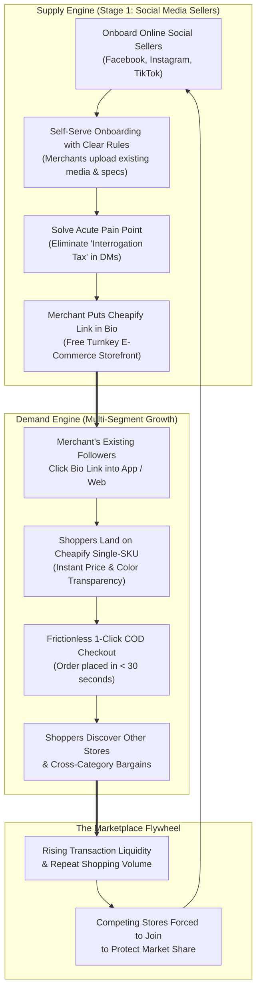
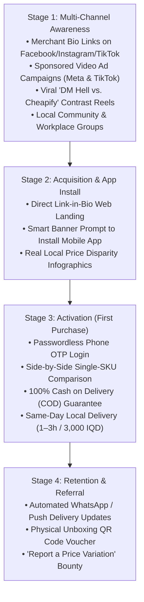

# Cheapify — Two-Sided Go-To-Market (GTM) Strategy & Execution Playbook

## Launchpad: Duhok Metropolitan Area | Expansion: Kurdistan Region & All Iraq

**Pillar:** Marketing (Pillar 2 — File 01)  
**Status:** Complete Strategy & Operational Playbook (Built 100% from Ground Zero)  
**Platform Architecture:** Native Mobile Application (iOS & Android) + Accessible Web Platform  
**Target Market:** Duhok Pilot Launchpad (Phase 1) ──► KRI & Northern Hubs (Phase 2) ──► Nationwide All-Iraq (Phase 3)  
**Core Marketing Channels:** Facebook, Instagram, and TikTok  
Cross-References:  

- Personas & User Journeys: [`../entrepreneurship/03_customer_and_merchant_personas.md`](../entrepreneurship/03_customer_and_merchant_personas.md)  
- Market Opportunity & Sizing: [`../entrepreneurship/02_market_opportunity_and_sizing.md`](../entrepreneurship/02_market_opportunity_and_sizing.md)  
- Competitive Advantage & Moats: [`../entrepreneurship/04_competitive_landscape_matrix.md`](../entrepreneurship/04_competitive_landscape_matrix.md)  
- Platform Fee Architecture: [`../platform/fee_structure_and_monetization.md`](../platform/fee_structure_and_monetization.md)  
- Hybrid "Best Value" Algorithm: [`../platform/best_value_algorithm_strategy.md`](../platform/best_value_algorithm_strategy.md)  
- Decisions & Preferences: [`../agent/decisions.md`](../agent/decisions.md) (ADR-008) | [`../agent/preferences.md`](../agent/preferences.md) (Preferences 6, 8, 9, 11, 12, 18, 19, 20, 21, 22, 23, 24)

---

## 1. Executive Strategy: Solving the Two-Sided Marketplace Dilemma

Every two-sided marketplace faces the classic **"Chicken-and-Egg" dilemma**: buyers will not install an app or browse a catalog without merchants and products, and merchants will not list products without active buyers.

Cheapify breaks this deadlock with a disciplined **Supply-First "Trojan Horse" Strategy**:



### 1.1 The Strategic Leap: Online Social Media Stores First (Stage 1)

As formulated in **ADR-008** and **Preference 19**, Cheapify does not begin by trying to digitize offline brick-and-mortar bazaar stalls. Instead, **Stage 1 focuses exclusively on existing online social media stores** (Instagram, Facebook, and TikTok shops):

1. **Zero Photography & Asset Overhead:** Social media sellers already have high-resolution photos, lifestyle unboxing reels, Kurdish/Arabic captions, and pre-compiled spec sheets stored on their smartphones. Catalog onboarding is rapid.
2. **Pre-Built E-Commerce Muscle:** Social sellers already pack parcels, coordinate daily with 3PL couriers (local fleets e.g. Fast Delivery; ZMC Express for inter-city), and collect Cash on Delivery (COD). They require zero logistics education.
3. **Acute DM Exhaustion ("Interrogation Tax"):** Social sellers are drowning in 50–100 repetitive DMs a day (*"Bihayê wê çende?", "What colors?", "Where are you located?"*) with an **85%+ ghost rate**. Cheapify is an immediate painkiller that automates their sales pipeline.
4. **Built-in Organic Traffic:** When an Instagram shop with 15,000 followers joins Cheapify and puts their Cheapify link in their bio, **they bring their entire existing customer base directly into Cheapify for free**, driving our customer acquisition cost (CAC) toward zero.

### 1.2 Dual Platform Delivery: Mobile App + Web

Cheapify is engineered as both a **native/PWA mobile app (iOS & Android)** and an accessible **web platform** ([Preference 20](../agent/preferences.md)):

- **Mobile App:** For recurring shoppers, push notifications, 1-tap reorders, live driver tracking, and instant merchant management.
- **Web Platform:** For instant, zero-friction discovery when shoppers tap a merchant's bio link or social ad on Facebook/Instagram without requiring a forced app download first. Once on the web landing page, smart banners prompt app installation.

---

## 2. Supply-Side Playbook: Social Media Merchant Acquisition & Onboarding

### 2.1 Target Merchant Profile (Stage 1 Cohort)

- **Primary Channels:** Active business accounts on **Facebook, Instagram, and TikTok** ([Preference 21](../agent/preferences.md)). Telegram is intentionally excluded from active focus.
- **Geographic Base:** Duhok metropolitan area (Duhok center, Malta, KRO, Semel, Zakho corridor).
- **Audience Size:** 1,500 to 50,000 followers.
- **Catalog Scope:** 20 to 150 standardized fast-moving retail SKUs across multi-category retail (Tech gadgets, mobile accessories, lifestyle items, beauty & personal care, home & kitchen, branded perfumes).
- **Current Operational Pain:** The shop owner or assistant spends 4 to 6 hours every day manually copying customer phone numbers, asking for landmark directions, and answering repetitive price questions in direct messages.

---

### 2.2 The 4-Pillar Merchant Value Proposition

| Pillar | Kak Kawa's Daily Frustration | Cheapify's Value Proposition |
| :--- | :--- | :--- |
| **1. DM Automation** | 80%+ of chat inquiries waste time asking *"Price?"* without buying. | **1-Click Checkout Link:** Put Cheapify in bio or send in DMs; buyers select color, enter address, and confirm order in 25 seconds via app or web. |
| **2. Self-Serve Control** | Reluctant to give control to third parties; wants immediate inventory updates. | **Turnkey Seller Dashboard:** Merchants upload their own products using clear, simple guidelines or match existing Single-SKU pages with one tap. |
| **3. Margin Protection** | Incumbent marketplaces (Miswag) charge 10%–15% commission, destroying 15%–20% retail margins. | **[Progressive Marginal Tiering](../platform/fee_structure_and_monetization.md):** 5% down to 1.5% take-rate. Kak Kawa keeps 95%–98.5% of his sales revenue. |
| **4. Free Paid Ad Boosts & Local Defense** | Hard to reach new buyers without expensive ad spend; out-of-city dumpers. | **Founding Store Ad Campaigns:** The first 20 stores get their products featured in Cheapify's paid ads on Facebook/Instagram/TikTok ([Preference 23](../agent/preferences.md)), while local 3k delivery protects their margins. |

---

### 2.3 Acquisition Channels & Direct Outreach Scripts

#### Channel A: Direct Instagram & Facebook Outreach

We initiate direct, personalized outreach to active Duhok and KRI social media sellers across Facebook and Instagram. Rather than sending a generic sales pitch, outreach targets their exact daily pain: **wasted time in DMs** and the offer of **free paid advertising**.

##### Outreach Script (Badînî Kurdish)

>
> *«Silav Kak [Navê Xwediyê Firoşgehê], karê we yê serkeftî be.*  
> *Me dît ku firoşgeha we [@Navê_Rûpelî] berhemên pir baş û taybet pêşkêş dike, lê em dizanin rojane çend seet ji dema we di bersivdana DM-yan de diçe bo pirsên mîna "Bihayê wê çende?" an "Ev reng heye?".*  
>
> *Em li **Cheapify** alîkariya firoşkarên serhêl yên Dihokê dikin ku firotina xwe 100% otomatîk bikin. Bi rêya App û Web-a me:*  
> *1. Hûn bi rênimayiyên hêsan berhemên xwe bi xwe bar dikin nav panela xwe ya taybet.*  
> *2. Mişterî bihayê zelal û rengan dibîne û bi 25 saniyan fermana xwe bi gehandina Duhokê temam dike.*  
> *3. Fermana amade rasterast digehe ser WhatsApp-a we bêyî tu axaftinên zêde.*  
>
> *🎁 **Taybet bo 20 firoşgehên pêşîn yên Dihokê:**  
> • Meha yekem **0% Komîsyon** e.  
> • **Em ê berhemên we di nav reklamên Cheapify yên bi sponsorî de li ser Facebook, Instagram û TikTok belav bikin (Reklama belaş bo firoşgeha we!)**.*  
>
> *Ma dest dide we vîdyoyeka 45-saniyeyî ya ceribandinê ji we re bişînim ku bibînin ka çawa dixebite?»*

##### Outreach Script (Arabic)

>
> *«مرحباً أخي [اسم صاحب المتجر]، عاشت إيدك على المتجر الرائع [@اسم_الصفحة].*  
> *نحن نعلم كمية الوقت والجهد الضائع يومياً في الرد على رسائل الخاص (الدايركت والماسنجر) لأسئلة مكررة مثل "السعر كم؟"، "اللون متوفر؟"، وتفاصيل التوصيل.*  
>
> *تطبيق ومنصة **Cheapify** صُممت خصيصاً لمتاجر الإنستغرام، فيسبوك، وتيك توك لتنظيم وأتمتة الطلبات:*  
> *1. من خلال إرشادات واضحة وبسيطة، تقوم بإضافة منتجاتك بنفسك وتتحكم بأسعارك ومخزونك بكل سهولة.*  
> *2. رابط واحد تضعه في البايو؛ الزبون يرى السعر النهائي ويطلب بضغطة زر خلال 25 ثانية فقط.*  
> *3. الطلب يصلك مؤكداً مع رقم الهاتف والعنوان الدقيق عبر الواتساب ولوحة التحكم.*  
>
> *🎁 **عرض حصري لأول 20 متجر في دهوك:**  
> • **عمولة 0%** للشهر الأول كاملاً.  
> • **سنقوم بعرض منتجات متجرك ضمن حملاتنا الإعلانية الممولة والممتازة على فيسبوك وإنستغرام وتيك توك (إعلانات مجانية ودعم مباشر لمبيعاتك!).**  
>
> *هل يناسبك أن أرسل لك فيديو تجريبي لمدة 45 ثانية يوضح كيف يعمل النظام؟»*

---

#### Channel B: The Founder WhatsApp "Video Proof" Strategy

Because founder **Shakir Bashar** is a software engineer who builds UX prototypes in-house ($0 agency cost), we leverage high-impact visual proof:

1. Shakir records a crisp, 45-second screen capture on an iPhone showing:
   - Clicking an Instagram/Facebook Bio link or opening the Cheapify mobile app.
   - Selecting a white Anker charger from the Single-SKU page.
   - 1-tap checkout with COD to Duhok Malta District.
   - Immediate WhatsApp order notification buzzing on the merchant's phone with customer name, phone number, and pre-formatted courier waybill.
2. Conversion rate on this specific video demo is extraordinarily high because merchants immediately see the elimination of their administrative nightmare.

---

### 2.4 Self-Serve Merchant Onboarding Workflow (Rules & Instructions Model)

In strict adherence to **Preference 22**, the Cheapify team does **NOT** manually scrape, extract media assets, or build product pages for merchants. Instead, Cheapify operates a **Self-Serve with Rules** onboarding model:

```text
[ Step 1: Merchant Access ] ──► [ Step 2: Quality Guidelines ] ──► [ Step 3: Self-Serve Catalog Setup ]
  Merchant receives invite        Merchant reviews clear rules:       Merchant either:
  and opens Merchant Portal       • Clean lighting / clear media      a) Matches existing Single-SKU (1-tap)
  on mobile app / browser         • Transparent IQD price             b) Uploads new product photos & specs
                                  • Accurate stock count                                │
                                                                                        ▼
[ Step 6: Free Ad Boost Live ]  ◄── [ Step 5: Bio Link Live ]   ◄── [ Step 4: Verification & Approval ]
  Merchant's products featured    Merchant puts cheapify.iq/@store     Cheapify automated QA checks
  in Cheapify's paid FB/IG ads    in bio & stories; orders open        listing against catalog rules (<2 hrs)
```

#### The Cheapify Merchant Standards & Rulebook

1. **Rule 1 — Absolute Price Integrity:** The price listed on Cheapify must match or beat the merchant's social media price. Artificial markups are prohibited.
2. **Rule 2 — Standardized Media Quality:** Photos must clearly display the actual product, manufacturer packaging, and available color variations without misleading watermarks.
3. **Rule 3 — Live Stock Guarantee:** Merchants agree to update stock status promptly. Order cancellations due to unrecorded out-of-stock items trigger reliability score deductions.
4. **Rule 4 — Standardized 3PL Delivery:** All orders are routed through Cheapify's standardized courier rates (3,000 IQD in Duhok). Merchants cannot add custom packaging or delivery surcharges.

---

### 2.5 The "Founder's Circle" Launch Program (First 20 Duhok Stores)

To secure the first 20 high-quality social sellers in Duhok, Cheapify provides an irresistible commercial bundle ([Preference 23](../agent/preferences.md)):

1. **0% Platform Commission (First 30 Days):** Merchants retain 100% of their product sales revenue, paying zero platform take-rate.
2. **Free Paid Advertising & Social Media Boost:** Cheapify finances and launches sponsored video ads across Facebook, Instagram, and TikTok explicitly showcasing the products and profiles of these 20 founding stores. Merchants gain hundreds of thousands of local video views and new buyers at **$0 cost to them**.
3. **Permanent "Verified Founding Merchant" Badge:** Gives them lasting algorithmic credibility and consumer trust across the app and web platform.

---

## 3. Demand-Side Playbook: Broad Consumer & Shopper Acquisition Engine

### 3.1 Target Consumer Segments (Broad Market Scope)

In compliance with **Preference 24**, Cheapify is a **broad mass-market consumer platform**, not a niche student-only app. While university students represent an energetic launchpad, Cheapify acquires and serves three distinct high-value consumer segments:

```text
┌──────────────────────────────────────────────────────────────────────────────────────────────────┐
│ CHEAPIFY CORE CONSUMER AUDIENCE SEGMENTS                                                         │
├──────────────────────────────────┬────────────────────────────────┬──────────────────────────────┤
│ 1. Young Working Professionals   │ 2. Household & Family Shoppers │ 3. Smart Deal Hunters & Youth│
│ (Ages 23 – 38)                   │ (Ages 26 – 48)                 │ (Ages 18 – 24)               │
├──────────────────────────────────┼────────────────────────────────┼──────────────────────────────┤
│ • Civil servants, office staff,  │ • Married men & women managing │ • University & college       │
│   private sector employees       │   family household purchases   │   students, budget shoppers  │
│ • Purchases: Tech gear, gadgets, │ • Purchases: Kitchen gadgets,  │ • Purchases: Phone cables,   │
│   smartwatches, perfumes, tools  │   home storage, personal care  │   fast chargers, gaming gear │
│ • Motivation: Time efficiency,   │ • Motivation: Budget savings,  │ • Motivation: Refusal to     │
│   no time to haggle in DMs,      │   reliable doorstep delivery,  │   overpay, seeking lowest    │
│   guaranteed transparent price   │   verified quality             │   price in Duhok             │
└──────────────────────────────────┴────────────────────────────────┴──────────────────────────────┘
```

---

### 3.2 The 4-Stage Consumer Acquisition Funnel



---

### 3.3 Consumer Acquisition Tactical Plays

#### Play 1: The Merchant Bio-Link Traffic Hijack (Zero-CAC Organic Engine)

- **The Mechanism:** Every onboarded merchant actively directs their existing follower base into Cheapify by placing their customized store link in their Instagram, TikTok, and Facebook bios: `cheapify.iq/@storename`.
- **The Story Trigger:** When a customer comments *"Price?"* on a merchant's Facebook or Instagram post, the merchant's automated reply sends:  
«Silav! Bo dîtina hemû rengan, bihayê dawî, û fermankirina bilez bi riya App/Web, lînka me ya di Bio-yê de bitikîne»
- **The Capture:** The shopper lands on Cheapify to buy from Kak Kawa, but immediately experiences Cheapify's clean interface, discovers other verified stores across 10 retail categories, and downloads the mobile app.

---

#### Play 2: Viral Short-Form Video Ads ("The Old Way vs. The Cheapify Way")

We produce high-contrast, relatable video ads running across **TikTok, Instagram Reels, and Facebook Video Feed**:

- **Creative Concept: "The DM Interrogation" (30-second Video)**
  - *Scene 1 (0–12s):* A young professional or student sends a DM on Instagram asking *"How much for this power bank?"*. 4 hours later, the page replies: *"Check DMs"*. He opens DMs, seller says: *"Send phone number first"*. Complete frustration.
  - *Scene 2 (13–25s):* Same shopper opens Cheapify. Searches "Anker 20,000mAh". Instantly sees 3 verified stores in Duhok side-by-side with transparent prices (28,000 IQD vs 33,000 IQD). Selects "Best Value" offer, chooses COD, and finishes in 25 seconds.
  - *Tagline:*  
«Bese westiyan di DM-yan de! Bi Cheapify re, biha zelal e û fermankirin bi 25 saniyan e.»
(Stop exhausting yourself in DMs! With Cheapify, prices are transparent and ordering takes 25 seconds).

---

#### Play 3: Targeted Paid Social Media Ad Boosts (Featuring Founding Stores)

- **Platforms:** Facebook Ads Manager & TikTok Ads Manager targeting Duhok metropolitan area (and expanding to Erbil/Mosul in Phase 2).
- **Format:** Carousel and dynamic product collection ads featuring the actual products of our 20 Founding Stores.
- **Copy Angle:** *"Found in Duhok: Anker Fast Charger for only 14,000 IQD. Verified Seller. 2-Hour Delivery. Cash on Delivery."*
- **Direct App Link:** Tap opens product directly in the Cheapify app / web checkout.

---

#### Play 4: Campus & Community Hub Partnerships (Launchpad Boost)

- **Campuses:** University of Duhok (UoD), American University of Kurdistan (AUK), Nawroz University.
- **Workplaces & Professional Hubs:** Outreach to local clinic staff, corporate office complexes, and public institutions where workers seek convenient lunchtime and evening shopping without roaming bazaar alleys.
- **Campus & Office Deal of the Week:** Exclusive weekly spotlight deals (e.g. 65W GaN laptop chargers, ergonomic desk accessories, car phone mounts) with free shipping vouchers on first orders.

---

#### Play 5: "Report a Price Variation" Community Bounty

- **The Concept:** Tap into the local consumer habit of taking screenshots when noticing outrageous price gaps between different shops on Facebook, Instagram, or street stores.
- **Mechanics:** Shoppers submit screenshots of identical items being sold with a $\ge 5,000\text{ IQD}$ price gap.
- **Reward:** Approved submissions receive a **3,000 IQD shipping credit** on their next Cheapify app order.
- **Dual Benefit:**
  1. Generates crowdsourced intelligence on real local price variations to feed our marketing proof library.
  2. Identifies new social stores for our merchant acquisition pipeline.

---

## 4. Launch Phasing & Geographic Scaling Horizon

In strict compliance with **Preference 12**, Cheapify expands geographically in three disciplined, phased stages:

```text
┌────────────────────────────────┐     ┌────────────────────────────────┐     ┌────────────────────────────────┐
│ PHASE 1: DUHOK LAUNCHPAD       │     │ PHASE 2: REGIONAL HUBS         │     │ PHASE 3: ALL-IRAQ SCALE        │
│ Months 1 – 6                   │ ──► │ Months 7 – 15                  │ ──► │ Months 16 – 24+                │
│ • Duhok Center, Malta, KRO     │     │ • Erbil, Mosul, Sulaymaniyah   │     │ • Baghdad, Basra, Kirkuk       │
│ • Semel & Zakho corridor       │     │ • 75 Verified Social Merchants │     │ • Central & Southern Iraq      │
│ • 20 Verified Social Merchants │     │ • Inter-City Courier Linehauls │     │ • 300+ Verified Merchants      │
│ • 3,000 Pilot Orders           │     │ • 15,000+ Regional Orders      │     │ • 50,000+ Nationwide Orders    │
└────────────────────────────────┘     └────────────────────────────────┘     └────────────────────────────────┘
```

### Phase 1: Duhok Pilot Launchpad (Months 1–6)

- **Operational Focus:** Prove the two-sided model in Duhok where physical merchant density and community trust are high.
- **Milestones:**
  - 20 active online social media merchants onboarded (self-serve with quality verification).
  - 150 Single-SKU master product pages created.
  - 3,000 completed orders delivered via local 3PL couriers (3,000 IQD flat fee).
  - Target customer satisfaction: $\ge 95\%$ on-time delivery; $< 3\%$ order return rate.

### Phase 2: Northern Regional Hubs — Erbil, Mosul, Sulaymaniyah (Months 7–15)

- **Operational Focus:** Activate inter-city logistics routes. Leverage the [Hybrid Best-Value Algorithm](../platform/best_value_algorithm_strategy.md) to enable Erbil wholesalers and Duhok retailers to compete dynamically without price dumping.
- **Milestones:**
  - 75 verified merchants across Duhok, Erbil, and Mosul.
  - 1,000+ Single-SKU listings across 10 retail sectors.
  - Establish regional hub linehaul integrations (ZMC Express 24–48h courier).

### Phase 3: Nationwide All-Iraq Scaling (Months 16–24+)

- **Operational Focus:** Expand platform infrastructure to Baghdad (Karrada, Mansour, Shorja), Basra, Kirkuk, and Southern governorates.
- **Milestones:**
  - Nationwide marketing campaigns in Iraqi Arabic across Facebook, Instagram, and TikTok.
  - Full electronic payment adoption (FIB, FastPay, Qi Card) alongside standard COD.
  - National distribution network covering all 18 Iraqi governorates.

---

## 5. Key Performance Indicators (KPIs) & Target Metrics

| Funnel Dimension | Metric | Pilot Target (Duhok Launch) | Scale Target (Year 1 End) | Measurement Method |
| :--- | :--- | :--- | :--- | :--- |
| **Merchant Acquisition** | Active Verified Social Stores | **20 Stores** | **75 Stores** | Dashboard active catalog verification |
| **Merchant Retention** | 30-Day Active Listing Retention | **$\ge 85\%$** | **$\ge 90\%$** | Monthly active SKU tracking |
| **Merchant CAC** | Cost to Acquire 1 Active Store | **<$10 USD** (Founder outreach) | **<$25 USD** | Direct outreach labor & ad test costs |
| **Shopper Acquisition** | Blended Customer Acquisition Cost (CAC) | **<$0.50 USD** | **<$0.80 USD** | Paid ad spend + incentives / new buyers |
| **App & Web Conversion** | Product View to Order Completion | **$\ge 3.5\%$** | **$\ge 4.5\%$** | App & web analytics checkout funnel |
| **Delivery Success** | First-Attempt Delivery Rate (COD) | **$\ge 92\%$** | **$\ge 95\%$** | 3PL courier delivery confirmation logs |
| **Customer Retention** | 60-Day Repeat Purchase Rate | **$\ge 30\%$** | **$\ge 38\%$** | Cohort repeat order analysis |

---

## 6. Founder-Led Competitive Advantages & Capital Discipline

Cheapify executes this GTM strategy with extreme capital efficiency, fully leveraging the competencies documented in [`../entrepreneurship/06_value_proposition_and_founder_fit.md`](../entrepreneurship/06_value_proposition_and_founder_fit.md):

1. **$0 External Software Agency Fees:** Founder Shakir Bashar develops the mobile app, web platform, merchant onboarding portal, and WhatsApp notifications in-house. Zero seed capital is wasted on expensive external development retainers.
2. **$0 Video Production Agency Fees:** All product demo reels, UX contrast videos, and social media ad creatives are produced, edited, and rendered in-house.
3. **100% Capital Focus on Direct Operations & Growth:** Available seed funding and operational resources are deployed exclusively to high-impact external growth levers:
   - Courier partnership onboarding and packaging materials.
   - Cloudflare / Supabase server reliability and WhatsApp Cloud API message credits.
   - Targeted paid ad campaigns on Facebook, Instagram, and TikTok featuring our 20 Founding Stores.
   - Legal Chamber of Commerce registration and local compliance.

---

## 7. Cross-Pillar Integration & Next Steps

- **Pillar 1 (Entrepreneurship):** Aligned with the Single-SKU architecture ([01_problem_solution_value.md](../entrepreneurship/01_problem_solution_value.md)) and dual personas ([03_customer_and_merchant_personas.md](../entrepreneurship/03_customer_and_merchant_personas.md)).
- **Platform Architecture:** Integrated with Progressive Marginal Tiering ([fee_structure_and_monetization.md](../platform/fee_structure_and_monetization.md)) and the Hybrid Best-Value Algorithm ([best_value_algorithm_strategy.md](../platform/best_value_algorithm_strategy.md)).
- **Growth Incentives:** The four-direction referral grid and catalog first-mover bounty are specified in [`../platform/referral_and_growth_incentives.md`](../platform/referral_and_growth_incentives.md) (ADR-012).
- **Next Deliverable in Pillar 2 (Marketing):**
  - **`marketing/02_brand_identity_and_guidelines.md`**: Ground-up visual identity, brand voice, design language, and **brand-new color palette from zero** (retiring all legacy colors per Preference 18).

---

## 8. Open Items Requiring Real-World Data

| Figure used in this doc | Source status | Needs |
| :--- | :--- | :--- |
| ~~85%+ DM ghost rate; 50–100 DMs/day per seller~~ | **SURVEY-VERIFIED (n=199):** 46% of shoppers cite "DM just to ask Price?" as a top-2 annoyance; **55% of merchants** cite repetitive price-DMs as their #1 headache | Daily-DM volume estimate (50–100) still anecdotal — refine via merchant interviews |
| Competitor commissions (Miswag/Elryan 10–15%) | Industry benchmark, unverified locally | Public fee pages / merchant interviews |
| Merchant gross margins 15–25% | Generic retail estimate | Merchant conversations during onboarding |
| Paid-ad CPM/CPC for Duhok targeting | Unpriced | Meta/TikTok Ads Manager test budget (~$20) |
| CAC targets (<$0.50 / <$0.80) | Aspirational goals | Recalibrate after first paid campaign data |
