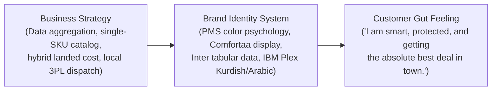
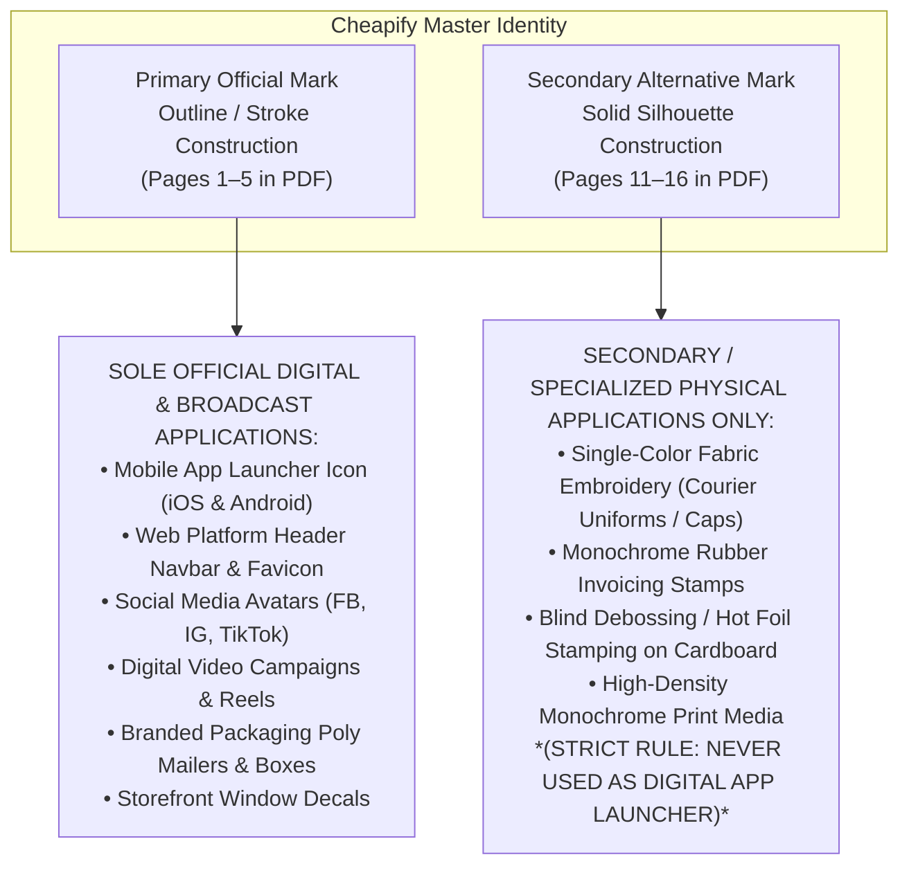
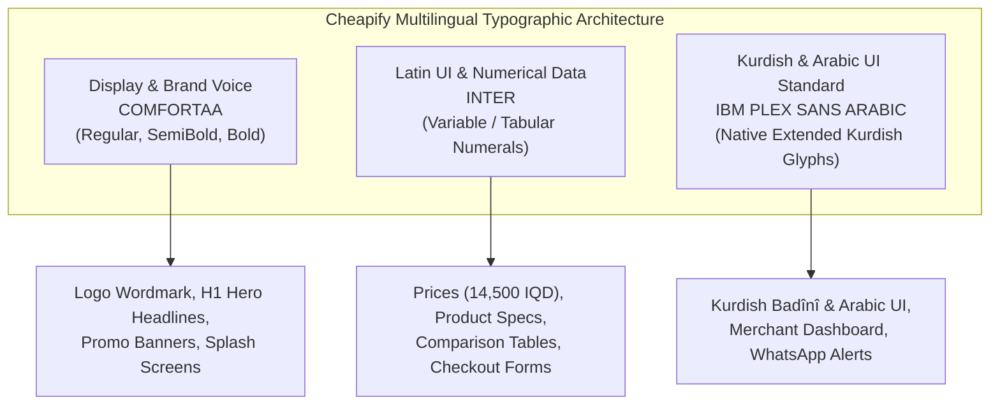
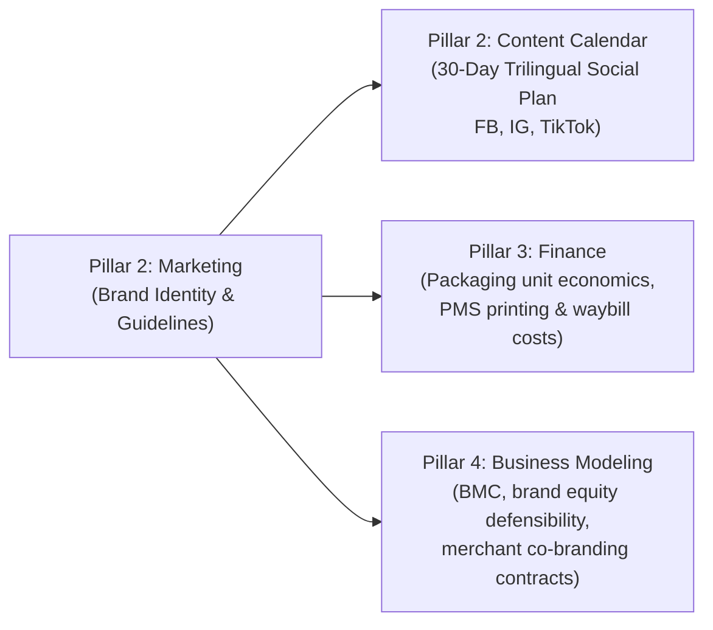

# Cheapify — Brand Identity & Visual Design Guidelines

## The Official Brand Style Guide & Enterprise Design System

**Pillar:** Marketing (Pillar 2 — Deliverable 02)  
**Status:** Official Corporate Brand Specification (Built 100% from Ground Zero)  
**Color Standard:** Strict Pantone Matching System (PMS) Standards  
**Source Asset:** [`../assets/Cheapify-LOGO.pdf`](../assets/Cheapify-LOGO.pdf)  
**Cross-References:**  

- Interactive HTML Brandbook: [`../brandbook/index.html`](../brandbook/index.html) (Live Single-File Specification)  
- Official Primary Domain: `getcheapify.com` ([Preference 27](../agent/preferences.md) · [ADR-010](../agent/decisions.md))  
- Go-to-Market Strategy: [`01_two_sided_gtm_strategy.md`](01_two_sided_gtm_strategy.md)  
- Customer & Merchant Personas: [`../entrepreneurship/03_customer_and_merchant_personas.md`](../entrepreneurship/03_customer_and_merchant_personas.md)  
- Competitive Advantage & Moats: [`../entrepreneurship/04_competitive_landscape_matrix.md`](../entrepreneurship/04_competitive_landscape_matrix.md)  
- Platform Fee Architecture: [`../platform/fee_structure_and_monetization.md`](../platform/fee_structure_and_monetization.md)  
- Hybrid "Best Value" Algorithm: [`../platform/best_value_algorithm_strategy.md`](../platform/best_value_algorithm_strategy.md)  
- Project Governance: [`../agent/decisions.md`](../agent/decisions.md) (ADR-007 through ADR-010) | [`../agent/preferences.md`](../agent/preferences.md) (Preferences 18–27)

---

## Table of Contents

1. [Brand Foundations, Strategy & Positioning](#1-brand-foundations-strategy--positioning)
2. [Brand Voice, Tone & Editorial Standards](#2-brand-voice-tone--editorial-standards)
3. [Tagline & Slogan Architecture](#3-tagline--slogan-architecture)
4. [Official Logo System & Geometry](#4-official-logo-system--geometry)
5. [Prohibited Logo Misuse & Guardrails](#5-prohibited-logo-misuse--guardrails)
6. [Official Color Palette System (Strict PMS Standards)](#6-official-color-palette-system-strict-pms-standards)
7. [Official Brand Typography Architecture](#7-official-brand-typography-architecture)
8. [UI Component System & Design Tokens](#8-ui-component-system--design-tokens)
9. [Iconography & Supporting Visual Elements](#9-iconography--supporting-visual-elements)
10. [Photography, Imagery & Merchant Asset Hygiene](#10-photography-imagery--merchant-asset-hygiene)
11. [Physical Brand Collateral & Packaging Experience](#11-physical-brand-collateral--packaging-experience)
12. [Marketplace Ecosystem & Co-Branding Rules](#12-marketplace-ecosystem--co-branding-rules)
13. [Brand Governance, Asset Directory & Version Control](#13-brand-governance-asset-directory--version-control)
14. [Cross-Pillar Implementation Roadmap](#14-cross-pillar-implementation-roadmap)

---

## 1. Brand Foundations, Strategy & Positioning

### 1.1 Brand Mission Statement

Cheapify exists to eliminate arbitrary price variation, price opacity, and the exhausting "Interrogation Tax" across Iraq and the Kurdistan Region. We empower everyday consumers with radical price transparency and single-click checkout, while equipping local merchants with turnkey automation that protects their retail margins.

### 1.2 Brand Vision

To become the definitive commerce operating system for Iraq and the Kurdistan Region—where every physical and social retailer is indexed, every consumer purchase is verified for best value, and shopping is entirely free of friction, negotiation anxiety, and hidden fees.

### 1.3 Marty Neumeier's "Onliness" Test (*Zag* Framework)

To establish authentic brand defensibility and market differentiation, Cheapify validates its strategic positioning using Marty Neumeier's foundational test:

> **"Cheapify is the ONLY multi-seller price comparison marketplace in Iraq and the Kurdistan Region that indexes local social media stores side-by-side on a single-SKU catalog, eliminates the exhausting 'DM for price' Interrogation Tax, and guarantees total doorstep landed cost ($P_{\text{item}} + D_{\text{tariff}}$) with single-click Cash-on-Delivery checkout."**

### 1.4 The Strategy-Design Bridge (*The Brand Gap*)

A brand is not merely a logo, a font, or a color palette; as defined in *The Brand Gap*, **a brand is a customer's gut feeling about a product, service, or organization**.

Our brand identity system is engineered to bridge corporate strategy with customer emotion:

- **The Business Strategy:** Aggregate fragmented supply, index prices across stores, optimize 3PL logistics, and reconcile weekly Cash-on-Delivery settlements.
- **The Customer Gut Feeling:** *"I am in control. I am never being overcharged. Shopping is fast, honest, and exciting."*
- **The Merchant Gut Feeling:** *"Cheapify respects my business, brings me real buying customers without extra ad spend, and makes my store look professional."*



### 1.5 Brand Archetypes: The Everyman Democratizer & The Sage Navigator

Cheapify balances two archetypes to maintain mass accessibility while projecting uncompromising technological competence:

1. **The Everyman / Democratizer (Primary - 60%):** Grounded, unpretentious, friendly, and fiercely loyal to the everyday consumer's wallet. Speaks the language of the local bazaar, respects hard-earned money, and champions everyday fairness.
2. **The Sage / Navigator (Secondary - 40%):** Mathematically objective, data-driven, and transparent. Cheapify never pushes biased sponsored products over better organic deals; it organizes market reality so users can make informed choices with complete confidence.

### 1.6 Core Brand Personality Attributes

1. **Radically Transparent:** Upfront pricing, clear item availability, and total doorstep cost ($P_{\text{total}} = P_{\text{item}} + D_{\text{tariff}}$) before checkout.
2. **Empowering & Optimistic:** We celebrate smart consumer choices and victory over price gouging.
3. **Approachable & Modern:** Warm geometric curves, friendly visual touchpoints, and intuitive mobile ergonomics.
4. **Operationally Precise:** Clean data tables, sharp tabular numerals, dependable order tracking, and clear receipts.

---

## 2. Brand Voice, Tone & Editorial Standards

### 2.1 The Four Voice Principles

Cheapify’s brand voice remains consistent across all languages (English, Badînî Kurdish, Standard Arabic), adapting its tone based on the user's emotional state and context:

1. **Street-Smart & Practical:** We talk like a trusted, financially savvy friend who knows the best shops in the bazaar. We avoid corporate buzzwords, tech jargon, and elitist phrasing.
2. **Direct & Action-Oriented:** We respect the user's time. Instructions are concise, buttons are clearly labeled, and product specs are immediately readable.
3. **Empathetic & Accountable:** When delivery delays or stock cancellations occur, we never deflect blame or write robotic apologies. We speak plainly, take responsibility, and provide immediate solutions.
4. **Culturally Grounded:** We celebrate the vibrant retail culture of Iraqi Kurdistan and federal Iraq, honoring local commerce traditions while modernizing the shopping experience.

---

### 2.2 Trilingual Contextual Tone Matrix

| Context / State | English Tone & Example | Badînî Kurdish Tone & Example | Iraqi Arabic Tone & Example |
| :--- | :--- | :--- | :--- |
| **Discovery & Browsing** | **Energetic & Empowering:**<br>"Compare 4 verified stores in Duhok. Save 4,500 IQD instantly." | **بئاقل و دەستخۆش:**<br>«4 فرۆشگەهێن دهۆکێ بەرهەڤ بکە. 4,500 دینار خلاس بکە.» | **حماسي ومباشر:**<br>«قارن بين 4 متاجر موثوقة في بغداد ووفر 4,500 دينار فوراً.» |
| **Checkout & Cart** | **Frictionless & Reassuring:**<br>"Doorstep total: 17,000 IQD. Pay cash upon arrival. No hidden fees." | **بێ خەم و زەلال:**<br>«سەرجەمێ گەهشتنێ: 17,000 دینار. دەما وەرگرتنێ ب کاش بدە. بێ چ هەقێن ڤەشارتی.» | **واضح ومطمئن:**<br>«المجموع عند الباب: 17,000 د.ع. الدفع نقداً عند الاستلام وبدون رسوم خفية.» |
| **Delivery Delays / Issues** | **Accountable & Solution-First:**<br>"Rain delayed your courier. We’re tracking it live; arriving in 35 mins." | **ڕاستگۆ و بەرپرسیار:**<br>«بارانێ گەهاندن دەرەنگ ئێخست. ئەم ڕاستەوخۆ دشۆپینین؛ 35 خولەکێن دی دگەهیتە تە.» | **صريح وسريع الحل:**<br>«المطر أخّر المندوب قليلاً. نتابع شحنتك لحظة بلحظة، وستصلك خلال 35 دقيقة.» |
| **Merchant Acquisition** | **Respectful & Value-Focused:**<br>"Keep your full profit. We bring real buyers directly to your stock." | **ڕێزدار و هەڤکار:**<br>«قازانجا خۆ بپارێزە. ئەم کڕیارێن ڕاستین دئینینە سەر بەرهەمێن تە.» | **مهني ومربح:**<br>«حافظ على أرباحك كاملة. نجلب لك زبائن جاهزين للشراء بدون عمولات مرهقة.» |

---

### 2.3 Tone Spectrum: "We Are / We Are Not"

- **We are Transparent, NOT Preachy:** We show the numbers clearly; we don't lecture users on how to spend their money.
- **We are Practical, NOT Cheap:** We champion *best value* and *smart economics*, never inferior quality or disposable junk.
- **We are Approachable, NOT Silly:** We use humor and street wit, but our financial calculations and delivery promises are deadly serious.
- **We are Modern, NOT Alienating:** We build high-tech e-commerce software, but design it so a grandmother in Zakho can use it effortlessly.

---

### 2.4 Marketplace Lexicon & Terminology Guide

To maintain brand authority across our mobile app, web platform, merchant dashboard, and social media channels, teams must adhere to the standardized terminology below:

| Approved Brand Term | Prohibited / Deprecated Term | Rationale |
| :--- | :--- | :--- |
| **Best Value / هەری باش / أفضل قيمة** | "Cheapest", "Discount Bin", "Rock-bottom" | "Cheapest" implies low quality; "Best Value" celebrates optimal price-to-quality ratio. |
| **Doorstep Total / سەرجەمێ گەهشتنێ / المجموع عند الباب** | "Price + Shipping", "Delivery Extra" | Eliminates checkout surprises by combining item price and local tariff upfront ($P_{\text{total}}$). |
| **Verified Local Partner / فرۆشکارێ پشتڕاستکری** | "Vendor", "Third-party Seller", "Merchant" | Elevates the store owner as a trusted local commerce partner. |
| **Instant Checkout / کڕینا ب ئێک کلیک / شراء فوري** | "DM for Price", "Ask in Private", "Chat to Order" | Emphasizes the eradication of the exhausting "Interrogation Tax". |
| **Price Variation / جوداهیا بهایان / تفاوت الأسعار** | "Price Gouging", "Cheating" | Maintains professional neutrality while diagnosing arbitrary price gaps across stores. |
| **Free Ad Showcase / پێشاندانا ڕێکلامێ یا بەلاش** | "Sponsored Push", "Paid Listing" | Accurately describes the free social ad boost granted to our 20 Founding Stores. |

---

## 3. Tagline & Slogan Architecture

Cheapify deploys a disciplined **Two-Tier Tagline Hierarchy** designed to serve both high-level institutional branding and high-converting performance marketing across Facebook, Instagram, and TikTok:

```
┌────────────────────────────────────────────────────────────────────────────────────────┐
│ TIER 1: BRAND SOUL & ASPIRATIONAL SLOGAN                                               │
│ «The bright side of choosing»                                                          │
├────────────────────────────────────────────────────────────────────────────────────────┤
│ • English: The bright side of choosing                                                 │
│ • Badînî Kurdish: «ڕوویێ گەش یێ هەلبژارتنێ»                                           │
│ • Arabic: «الجانب المشرق للاختيار»                                                    │
│ • Strategic Role: Emotional anchor used in corporate pitch decks, billboard campaigns, │
│   app launch splash screens, and brand manifestos. Transforms shopping from an         │
│   exhausting chore into an empowering, confident lifestyle choice.                     │
└────────────────────────────────────────────────────────────────────────────────────────┘

┌────────────────────────────────────────────────────────────────────────────────────────┐
│ TIER 2: FUNCTIONAL CAMPAIGN HOOKS & APP STORE DESCRIPTORS                              │
│ «Find your best deal»  •  «Smart Deals. Verified Sellers. One App.»                   │
├────────────────────────────────────────────────────────────────────────────────────────┤
│ • Primary Hook (EN / KU / AR):                                                         │
│   - EN: Find your best deal                                                            │
│   - KU: «باشترین بها ببینە»                                                         │
│   - AR: «أفضل صفقة، بأسهل طريقة»                                                      │
│ • App Store Subtitle & Bio Hook:                                                       │
│   - EN: Smart Deals. Verified Sellers. One App.                                        │
│   - KU: «داشکاندنێن ب ئاقل. فرۆشکارێن پشتڕاست. ئێک ئەپ.»                             │
│   - AR: «صفقات ذكية. متاجر موثوقة. تطبيق واحد.»                                        │
│ • Strategic Role: Instant clarity in 3-second social video ads, Google Play / App Store│
│   metadata, and Instagram/TikTok bio headers. Directly communicates platform utility.  │
└────────────────────────────────────────────────────────────────────────────────────────┘
```

---

## 4. Official Logo System & Geometry

The official Cheapify logo mark is constructed from the master vector blueprint documented in [`../assets/Cheapify-LOGO.pdf`](../assets/Cheapify-LOGO.pdf).

### 4.1 Visual Anatomy & Symbolism

- **The Shopping Bag (Structural Base):** Represents the reliable e-commerce marketplace framework, indexing thousands of standardized consumer SKUs.

- **The Upward Arrow (Integrated Core):** Embedded within the negative space of the bag, pointing upward to signify ascending financial savings, superior quality, and elevated consumer agency.
- **The Magnifying Glass (Dynamic Swoosh & Lens):** Sweeps dynamically across the lower right boundary in **PANTONE 7731 C** green, symbolizing deep market discovery, deal inspection, and the eradication of hidden markups.

---

### 4.2 Logo Construction Hierarchy



1. **Primary Official Mark (Outline Style - Pages 1–5 in PDF):**
   - The **sole official representation** of the Cheapify brand across all digital platforms.
   - Features the primary blue outline shopping bag with open negative space, centered upward arrow, and the vivid green magnifying glass swoosh.
   - **Mandatory for:** Mobile App Launcher Icon, Web Header, Favicons, Social Media Profiles, Digital Ads, and Delivery Packaging.
2. **Secondary Alternative Mark (Solid Silhouette - Pages 11–16 in PDF):**
   - A secondary physical asset engineered strictly for specialized manufacturing methods where fine vector outlines cannot reproduce accurately (e.g., fabric stitching, hot foil stamping, rubber stamps).
   - **Strict Digital Guardrail:** **Never used as the digital mobile app icon, web favicon, or social media avatar.**

---

### 4.3 Master Grid & Responsive Scaling Standards

The master vector symbol is constructed on a `700px × 900px` bounding box (Aspect Ratio: `7 : 9` or `1 : 1.2857`).

#### The Proportional Scaling Specification

Because the master vector ratio is $7:9$, calculating height directly from round widths yields non-terminating decimal fractions:
$$500\text{px} \times \frac{9}{7} = 642.857\dots\text{px} \quad\Big|\quad 300\text{px} \times \frac{9}{7} = 385.714\dots\text{px} \quad\Big|\quad 200\text{px} \times \frac{9}{7} = 257.142\dots\text{px}$$

In graphic design software (e.g., Adobe Illustrator exports or PDF viewers), these fractions are automatically truncated to whole integers (`642px`, `385px`, etc.), which can introduce slight sub-pixel rounding errors if height is forced manually.

**Strict Implementation Rule:**

- **Width Benchmark Only:** In all UI code, web implementations, mobile views, and asset exports, **always set target width with proportional automatic height** (`width: {W}px; height: auto;` or rely on SVG `viewBox="0 0 700 900"`).
- **Do not specify or force a fixed pixel height.** This preserves the exact $7:9$ vector geometry across all screen resolutions without sub-pixel truncation or aspect-ratio distortion.

| Implementation Tier | Target Width | Scaling Rule | Clear Space ($X$) | Recommended Asset Format |
| :--- | :--- | :--- | :--- | :--- |
| **Hero / Billboard / Print** | `500px` | Proportional `auto` (7:9) | `50px` | Vector SVG / EPS / PDF |
| **Standard Web Header** | `300px` | Proportional `auto` (7:9) | `30px` | Vector SVG / WebP |
| **Tablet / Mobile Navbar** | `200px` | Proportional `auto` (7:9) | `20px` | Vector SVG / PNG |
| **App Launcher Icon / Grid** | `100px` | Proportional `auto` (7:9) | `12px` | High-DPI Vector / PNG |
| **Micro Favicon / Status Chip** | `32px` | Proportional `auto` (7:9) | `4px` | Scaled SVG / ICO |

- **Minimum Digital Width:** `24px` width (below this threshold, the magnifying glass stroke loses definition).
- **Minimum Print Width:** `15mm` width.
- **Clear Space Rule ($X$):** The exclusion boundary surrounding the mark must equal or exceed the diameter of the shopping bag handle eyelets ($X$). No typography, borders, or graphic elements may intrude into this zone.

---

## 5. Prohibited Logo Misuse & Guardrails

To protect the integrity, legal defensibility, and visual authority of the Cheapify identity, internal teams, external agencies, and merchant partners must never subject the logo to the following violations:

```
┌────────────────────────────────────────────────────────────────────────────────────────┐
│ THE CHEAPIFY "LOGO DON'TS" — 8 STRICT COMPLIANCE RULES                                 │
├────────────────────────────────────────────────────────────────────────────────────────┤
│ 1. DO NOT SKEW OR DISTORT: Never alter the 7:9 aspect ratio or stretch horizontally.  │
│ 2. DO NOT ROTATE: Never tilt, flip, or place the logo at an angle.                     │
│ 3. DO NOT ALTER COLORS: Never replace official PMS colors with unapproved tints.       │
│    (Never use retired legacy colors like Jade Green #148C53 or Boston Blue).           │
│ 4. DO NOT SWAP ACCENTS: Never make the bag green and the magnifying glass blue.        │
│ 5. DO NOT USE SOLID DIGITALLY: Never use the solid silhouette as the mobile app icon.  │
│ 6. DO NOT ADD EFFECTS: Never add unapproved drop shadows, outer glows, or 3D bevels.  │
│ 7. DO NOT SEPARATE ELEMENTS: Never detach the magnifying glass or reposition arrow.    │
│ 8. DO NOT VIOLATE CLEAR SPACE: Never crowd the logo with text, icons, or busy photos. │
└────────────────────────────────────────────────────────────────────────────────────────┘
```

---

## 6. Official Color Palette System (Strict PMS Standards)

Cheapify’s color system is anchored strictly in the **Pantone Matching System (PMS)** documented on Page 5 of [`../assets/Cheapify-LOGO.pdf`](../assets/Cheapify-LOGO.pdf). All legacy, informal color names (such as "Jade Green" and "Boston Blue") are permanently retired ([Preference 18](../agent/preferences.md)).

```
┌────────────────────────────────────────────────────────────────────────────────────────┐
│ CHEAPIFY OFFICIAL CORE PALETTE (STRICT PANTONE MATCHING SYSTEM)                        │
├─────────────────────┬─────────────────────┬─────────────────────┬──────────────────────┤
│ PRIMARY BRAND BLUE  │ BRAND DEAL GREEN    │ DARK BASE / INK     │ LIGHT NEUTRAL SURFACE│
│ PANTONE 7689 C      │ PANTONE 7731 C      │ PANTONE BLACK 6 C   │ PANTONE 656 C        │
├─────────────────────┼─────────────────────┼─────────────────────┼──────────────────────┤
│ HEX: #298FC2        │ HEX: #228848        │ HEX: #101820        │ HEX: #DDE5ED         │
│ RGB: 41, 143, 194   │ RGB: 34, 136, 72    │ RGB: 16, 24, 32     │ RGB: 221, 229, 237   │
│ CMYK: 79, 26, 0, 24 │ CMYK: 75, 0, 47, 47 │ CMYK: 50, 25, 0, 87 │ CMYK: 7, 3, 0, 7     │
│ HSL: 200°, 65%, 46% │ HSL: 142°, 60%, 33% │ HSL: 210°, 33%, 9%  │ HSL: 210°, 31%, 90%  │
│ Contrast on White:  │ Contrast on White:  │ Contrast on White:  │ Contrast on Dark:    │
│ 3.62:1 (Large / UI) │ 4.48:1 (Passes AA)  │ 16.8:1 (Passes AAA) │ 13.5:1 (Passes AAA)  │
│ Role: Core Identity │ Role: "Best Value"  │ Role: Text, Titles, │ Role: App Surfaces,  │
│ Brand Blue & Buttons│ Badge & Savings     │ Dark Mode Cards     │ Card Backgrounds     │
└─────────────────────┴─────────────────────┴─────────────────────┴──────────────────────┘
```

### 6.1 Technical Color Breakdown

#### 1. Primary Brand Blue — PANTONE 7689 C

- **Color Values:** `HEX: #298FC2` | `RGB(41, 143, 194)` | `CMYK(79, 26, 0, 24)` | `HSL(200°, 65%, 46%)`

- **Brand Psychology:** Communicates digital clarity, speed, transparency, and modern technological efficiency.
- **Application Standards:** Primary shopping bag outline, brand navigation headers, primary call-to-action buttons, active navigation tab bars, and official courier delivery packaging.
- **Accessibility Note:** Delivers a computed `3.62:1` contrast ratio against white. Meets WCAG AA requirements for graphical UI components, icons, and large display text ($>18\text{pt}$). For smaller body copy, pair with PANTONE BLACK 6 C.

#### 2. Brand Deal Green — PANTONE 7731 C

- **Color Values:** `HEX: #228848` | `RGB(34, 136, 72)` | `CMYK(75, 0, 47, 47)` | `HSL(142°, 60%, 33%)`

- **Brand Psychology:** The unmistakable signal of victory, authentic savings, verified merchants, and financial relief.
- **Application Standards:** The dynamic magnifying glass swoosh, the signature **"Best Value"** badge, discount price-drop chips, and checkout order success confirmations.
- **Accessibility Note:** Delivers a computed `4.48:1` contrast ratio on white backgrounds (passing WCAG AA for Large Text and effectively meeting AA threshold for UI tags and badges).

#### 3. Dark Base / Ink — PANTONE BLACK 6 C

- **Color Values:** `HEX: #101820` | `RGB(16, 24, 32)` | `CMYK(50, 25, 0, 87)` | `HSL(210°, 33%, 9%)`

- **Brand Psychology:** A deep, premium charcoal-ink with a subtle cool undertone, avoiding the harsh glare of `#000000`.
- **Application Standards:** All primary typography, headings, data tables, and high-contrast dark mode UI surfaces.

#### 4. Surface Light Neutral — PANTONE 656 C

- **Color Values:** `HEX: #DDE5ED` | `RGB(221, 229, 237)` | `CMYK(7, 3, 0, 7)` | `HSL(210°, 31%, 90%)`

- **Brand Psychology:** An ice-tinted off-white engineered to reduce screen glare under bright Middle Eastern sunlight.
- **Application Standards:** Screen background fills, card borders, zebra-striping in comparison tables, and subtle divider lines.

---

### 6.2 Semantic & Utility PMS Color Extensions

To handle real-time e-commerce operational states (flash countdowns, out-of-stock notices, delivery alerts), the system includes standardized utility tokens:

| Semantic State | PMS Reference | HEX Code | RGB | Purpose in App / Web |
| :--- | :--- | :--- | :--- | :--- |
| **Flash Deal / Urgent Saving** | **PANTONE 137 C** | `#FFA300` | `255, 163, 0` | Limited-time deals, countdown timers, campus specials. |
| **Warning / Low Stock** | **PANTONE 151 C** | `#FF8200` | `255, 130, 0` | "Only 2 left in stock", courier weather delay notices. |
| **Error / Cancelled** | **PANTONE 1795 C** | `#D22730` | `210, 39, 48` | Out of stock, invalid phone number, order cancelled. |
| **Pure White Surface** | Pure White | `#FFFFFF` | `255, 255, 255` | Elevated product card surfaces, clean modal dialogs. |

- **Text on Flash/Warning:** Pure White (`#FFFFFF`) text is used on `#FFA300` and `#FF8200` fills. Both pairings reach ~2.0–2.5:1 contrast, so they are reserved for large, bold, short-lived UI (badges, countdowns) — never for body copy.

---

### 6.3 The 60-30-10 Color Balance Rule

To avoid visual fatigue and maintain conversion focus, digital screens and physical collateral follow the classic 60-30-10 distribution:

- **60% Neutral Surfaces:** Clean White (`#FFFFFF`) and Light Neutral (**PANTONE 656 C**) provide breathing room and background structure.
- **30% Structural Dark Ink:** **PANTONE BLACK 6 C** anchors all typographic hierarchy, specifications, and comparison table text.
- **10% High-Impact Accents:** **PANTONE 7689 C** (Primary Blue) directs the eye to key actions, while **PANTONE 7731 C** (Green) is reserved exclusively for winning **Best Value** badges and verified savings.

---

## 7. Official Brand Typography Architecture

Cheapify establishes a cohesive tri-font typographic hierarchy designed for high-conversion e-commerce across Iraq and the Kurdistan Region:



---

### 7.1 Primary Brand Display Font: Comfortaa

- **Designer:** Johan Aakerlund | **License:** Open Font License (OFL)

- **Design Traits:** Rounded geometric sans-serif based on circular proportions. Friendly, approachable, modern, and distinct.
- **Role & Strict Usage Rules:**
  - **Approved for:** Logo wordmark (`Cheapify`), Top-level Hero Headlines (H1), promotional landing page banners, splash screens, and signature marketing badges.
  - **Prohibited for:** Body text, multi-line product descriptions, dense spec sheets, and price data tables (due to excessive horizontal tracking and reading fatigue).

---

### 7.2 Latin UI & Pricing Data Font: Inter

- **Designer:** Rasmus Andersson | **License:** Open Font License (OFL)

- **Design Traits:** Engineered specifically for computer screens and mobile operating systems. Tall x-height, distinct letterforms (`1`, `l`, `I` clarity), and mathematically perfect pixel alignment.
- **Role & Strict Usage Rules:**
  - **Approved for:** All English UI text, product specifications, store addresses, checkout forms, customer reviews, and **all numerical pricing**.
  - **Tabular Figures Feature:** Must always be configured with `font-variant-numeric: tabular-nums` in CSS. This ensures price columns align vertically across competing stores without character jitter:

    ```css
    .cheapify-price {
      font-family: 'Inter', -apple-system, sans-serif;
      font-variant-numeric: tabular-nums;
      font-weight: 700;
    }
    ```

---

### 7.3 Kurdish & Arabic Regional UI Font: IBM Plex Sans Arabic

- **Designer:** Mike Abbink & Wael Morcos (IBM) | **License:** Open Font License (OFL)

- **Design Traits:** Engineered by IBM for enterprise software clarity across the Arab world and regional languages. Modern, technical, authoritative, with balanced baseline rhythm.
- **Native Kurdish Unicode Verification:**
  - Flawlessly renders all Central/Badînî Kurdish characters without broken kerning or missing diacritics:
    $$\text{Kurdish Glyphs: } \text{ڕ } (\text{U+0695}),\ \text{ڵ } (\text{U+06B5}),\ \text{ڤ } (\text{U+06A4}),\ \text{ێ } (\text{U+06CE}),\ \text{ۆ } (\text{U+06C6}),\ \text{ژ},\ \text{چ},\ \text{پ},\ \text{گ}$$
- **Role & Strict Usage Rules:**
  - **Approved for:** 100% of Kurdish (Badînî & Sorani, Kurdish Arabic-based script only) and Standard Arabic UI text, category names, merchant dashboard menus, and customer service messaging.

---

### 7.4 Cross-Platform Typographic Scale Matrix

| Role | Token Name | Size (px / pt) | Line Height | Font Family | Weight | Tracking |
| :--- | :--- | :--- | :--- | :--- | :--- | :--- |
| **Hero Display** | `type-hero` | `36px – 44px` | `1.2` | **Comfortaa** | Bold (700) | `-0.02em` |
| **Page Title (H1)** | `type-h1` | `28px – 32px` | `1.25` | **Comfortaa** | SemiBold (600) | `-0.01em` |
| **Section Title (H2)** | `type-h2` | `20px – 24px` | `1.3` | **Inter / IBM Plex** | SemiBold (600) | `0em` |
| **Card Title (H3)** | `type-h3` | `16px – 18px` | `1.35` | **Inter / IBM Plex** | Medium (500) | `0em` |
| **Price Tag (Hero)** | `type-price-lg` | `22px – 26px` | `1.1` | **Inter** (Tabular) | Bold (700) | `+0.01em` |
| **Price Tag (Table)** | `type-price-sm` | `15px – 17px` | `1.2` | **Inter** (Tabular) | SemiBold (600) | `0em` |
| **Body Regular** | `type-body` | `14px – 15px` | `1.5` | **Inter / IBM Plex** | Regular (400) | `0em` |
| **Caption / Badge** | `type-caption` | `11px – 12px` | `1.4` | **Inter / IBM Plex** | Medium (500) | `+0.02em` |

---

### 7.5 Numerals, Currencies & Price Formatting Architecture

Because Iraqi commerce operates with large nominal amounts (e.g., thousands of Iraqi Dinars), consistent numeral formatting is critical to prevent checkout errors:

- **Currency Placement:** Space separated after the numerical amount in English and Kurdish (`14,500 IQD`), or before/after standard Arabic format (`١٤,٥٠٠ د.ع` or `14,500 د.ع`).
- **Digit Grouping:** Always use standard thousands commas (`14,500`, never `14500`).
- **Decimal Rule:** Iraqi Dinar (IQD) has no practical subunit (no fils); **never display decimals for IQD** (`14,500 IQD`, never `14,500.00 IQD`). For USD payments, use two standard decimals (`$12.50`).

---

## 8. UI Component System & Design Tokens

### 8.0 Official Design Language — "Clean Flat + Soft Depth"

Cheapify's user interface design style is formally defined as **Clean Flat + Soft Depth** ([ADR-009](../agent/decisions.md) · [Preference 25](../agent/preferences.md)). It was selected by the founder from a field of 8 candidate design styles rendered as live visual samples in the official PMS palette and brand fonts ([`../assets/design-style-previews/index.html`](../assets/design-style-previews/index.html)).

**Why this style:** Cheapify's users range from digitally fluent students to bazaar merchants and family shoppers with low digital literacy, across three languages and two scripts. The interface must make dense price-comparison data feel effortless. Flat surfaces maximize readability; restrained depth signals interactivity without decoration; disciplined PMS accents keep the "Best Value" signal unmistakable. It is the visual embodiment of *Radically Transparent* and *Operationally Precise*.

#### 8.0.1 Core Principles

1. **Flat White Surfaces:** All cards, sheets, and content containers render as Pure White (`#FFFFFF`) over light neutral backgrounds (`#DDE5ED` / `#F4F6F8`). Content never sits on gradients, glass, or textured fills.
2. **Soft Depth, Never Drama:** Elevation is communicated by a single, diffuse, neutral shadow plus a hairline border. Shadows are always `rgba(16,24,32,α)` tinted by PANTONE BLACK 6 C — never colored, never hard-offset, never stacked multiples.
3. **Rounded & Friendly Geometry:** Generous corner radii echo Comfortaa's circular letterforms and the outline logo's organic strokes — `12px–16px` on cards, `10px–12px` on buttons, fully rounded `999px` pills on badges and chips.
4. **Disciplined Accent Economy:** PANTONE 7689 C Blue appears only on primary actions, links, and active states. PANTONE 7731 C Green appears *exclusively* on Best Value badges, verified signals, and savings figures. Everything else stays neutral.
5. **Breathing Room:** Minimum `16px` interior card padding and `12px+` vertical gaps between comparison rows — dense data must never feel cramped.

#### 8.0.2 The 3-Level Elevation Scale

| Level | Name | Surface | Border | Shadow | Usage |
| :--- | :--- | :--- | :--- | :--- | :--- |
| `elev-0` | Base | `#F4F6F8` or `#DDE5ED` | None | None | Screen/app background |
| `elev-1` | Card | `#FFFFFF` | `1px solid rgba(16,24,32,.04)` or `#DDE5ED` | `0 2px 8px rgba(16,24,32,.04)` | Product cards, comparison rows, form panels |
| `elev-2` | Overlay | `#FFFFFF` | `1px solid rgba(16,24,32,.04)` | `0 8px 24px rgba(16,24,32,.08)` | Modals, bottom sheets, dropdowns, floating CTA bars |

- **Strict rule:** `elev-2` is the maximum shadow intensity ever permitted. No component may exceed it.

#### 8.0.3 Corner Radius Scale

| Token | Radius | Application |
| :--- | :--- | :--- |
| `radius-sm` | `8px` | Chips, small tags, input fields |
| `radius-md` | `10px–12px` | Buttons, comparison rows |
| `radius-lg` | `16px` | Product cards, modals, bottom sheets |
| `radius-pill` | `999px` | Best Value badge, status pills, toggles |

#### 8.0.4 Explicitly Prohibited Visual Treatments

The following styles were evaluated and **rejected**; they must never appear in Cheapify UI, merchant dashboards, or marketing mockups:

- **Neo-brutalist / sticker treatment:** hard offset drop shadows, thick black borders, rotated elements.
- **Dopamine gradients:** saturated multi-color gradient fills behind cards or CTAs (gradients may appear only in *marketing* hero art, never as functional UI surfaces).
- **Glassmorphism / backdrop blur:** frosted translucent layers (readability and low-end Android performance risk).
- **Neumorphism / Claymorphism:** extruded or puffy inner-shadow surfaces (fails WCAG contrast on data tables).
- **Gamification HUD chrome:** streak counters, point meters, and progress bars as decorative interface framing. (Savings figures and the Best Value badge may *communicate* gamified wins — as content, not chrome.)
- **Editorial Zero-UI:** unbounded text-only layouts without card containment for price data.

#### 8.0.5 Approved Optional Patterns

- **Bento stat tiles:** Modular `elev-1` white tiles of varying sizes are approved for dashboards and "deal summary" surfaces (e.g., a 2×2 cluster showing *You Save / Stores Compared / Delivery / Doorstep Total*). Tiles stay flat white — the bento pattern governs *layout*, not surface treatment.
- **Dark mode (optional Phase 2):** When implemented, dark mode inverts to `elev-0 = #101820` (PMS BLACK 6 C) and `elev-1 = #1A2530` with identical radius/shadow rules. It is a theme variant, not a style change.

---

### 8.1 The Signature "Best Value" Badge

The Best Value badge is Cheapify's signature trust mark. It indicates that the algorithm has evaluated all active verified sellers and determined that this offer yields the **lowest total doorstep price** ($P_{\text{item}} + D_{\text{tariff}}$).

```
┌─────────────────────────────────────────────────────────┐
│ UI TOKEN SPECIFICATION: BestValueChip                   │
├─────────────────────────────────────────────────────────┤
│ Background:  PANTONE 7731 C (#228848) with 10% tint     │
│              or solid #228848 on dark cards             │
│ Text / Icon: PANTONE 7731 C (#228848) in light mode     │
│              Pure White (#FFFFFF) in solid mode         │
│ Font:        Inter SemiBold (Tabular) / IBM Plex Arabic │
│ Size:        12px font-size • 4px padding • 6px radius  │
│ Icon:        Checkmark or Star spark (Left aligned)     │
│ Copy:        ★ BEST VALUE • هەری باش • أفضل قيمة   │
└─────────────────────────────────────────────────────────┘
```

---

### 8.2 Button Design Tokens & Ergonomics

All interactive button targets on mobile touch screens must maintain a **minimum height of 48px** to satisfy Apple HIG and Google Material ergonomics:

| Button Type | Background Color | Text Color | Border | Border Radius | Min Height | State Behavior |
| :--- | :--- | :--- | :--- | :--- | :--- | :--- |
| **Primary CTA (Order Now)** | **PANTONE 7689 C** (`#298FC2`) | Pure White (`#FFFFFF`) | None | `10px` | `48px` | Darkens to `#2177A3` on tap |
| **Success CTA (Best Deal)** | **PANTONE 7731 C** (`#228848`) | Pure White (`#FFFFFF`) | None | `10px` | `48px` | Darkens to `#1A6D38` on tap |
| **Secondary Button** | Transparent / White | **PANTONE BLACK 6 C** | `1px solid #DDE5ED` | `10px` | `44px` | Background shifts to `#F0F4F8` |
| **Ghost Button (View More)** | Transparent | **PANTONE 7689 C** | None | `8px` | `40px` | Underline on hover/tap |

---

### 8.3 Card & Single-SKU Comparison Table Architecture

- **Card Container:** Pure White (`#FFFFFF`) surface, `12px` rounded corners, bordered by a crisp `1px solid #DDE5ED` (PANTONE 656 C). Soft box shadow: `0 2px 8px rgba(16, 24, 32, 0.04)`.
- **The Single-SKU Comparison Table:**
  - **Winning Store Row:** Highlighted with an ultra-light tint of **PANTONE 7731 C** (`rgba(34, 136, 72, 0.05)`) with the green Best Value chip prominently pinned.
  - **Alternative Store Rows:** Clean white surface with subtle divider lines (`#DDE5ED`), displaying transparent delivery time and price delta (`+1,500 IQD`).

```
┌────────────────────────────────────────────────────────────────────────┐
│ SINGLE-SKU PRICE COMPARISON CARD (MOBILE VIEW)                         │
├────────────────────────────────────────────────────────────────────────┤
│ Anker 20W USB-C Nano Fast Charger (Black)                              │
│ Catalog SKU: EL-ANK-20W-BLK • 1 Year Warranty                          │
├────────────────────────────────────────────────────────────────────────┤
│ ★ هەری باش (BEST VALUE OFFER)                                     │
│ Kawa Electronics (Duhok Bazaar) • 4.9 ★ (120 reviews)                  │
│ Item: 14,000 IQD  •  Delivery: 3,000 IQD  •  Doorstep Total: 17,000 IQD│
│ ⚡ Arrives in 2 Hours (Local)  [ ORDER CASH ON DELIVERY ] (Blue CTA)   │
├────────────────────────────────────────────────────────────────────────┤
│ OTHER VERIFIED SELLERS:                                                │
│ • FastTech Duhok:  15,000 IQD + 3,000 IQD = 18,000 IQD (+1,000 IQD)    │
│ • Baghdad Digital: 13,500 IQD + 6,000 IQD = 19,500 IQD (+2,500 IQD)    │
└────────────────────────────────────────────────────────────────────────┘
```

---

### 8.4 Mobile App Launcher Icon & Favicon Specifications

- **App Launcher Composition:**
  - **Background Container:** Pure White (`#FFFFFF`) or Deep Dark Ink (**PANTONE BLACK 6 C**).
  - **Logo Symbol:** Primary **Outline Mark** centered within the container.
  - **Proportions:** The outline symbol occupies exactly **65% of the total icon grid height and width**, providing a mandatory 17.5% clear margin on all four sides to prevent OS squircle clipping on iOS and Android:

    ```
    ┌──────────────────────────────────┐
    │          17.5% Margin            │
    │     ┌──────────────────────┐     │
    │     │                      │     │
    │17.5%│   65% Outline Logo   │17.5%│
    │     │                      │     │
    │     └──────────────────────┘     │
    │          17.5% Margin            │
    └──────────────────────────────────┘
    ```

- **Favicon Standard (Web Platform):** SVG vector favicon with fallback `32px × 32px` ICO containing the outline symbol.

---

## 9. Iconography & Supporting Visual Elements

### 9.0 The Zero-Emoji Rule

Cheapify **never uses emojis** in any user interface, document, marketing material, social media content, merchant communication, or internal artifact — no exceptions ([Preference 26](../agent/preferences.md)). All expressive visuals are rendered as proper vector iconography:

- **Approved sources:** Custom-drawn icons per §9.1, or free CDN icon libraries — **Lucide** (lucide.dev; its clean `2px` rounded-stroke geometry matches our spec exactly), **Phosphor Icons**, **Heroicons**, or the **Iconify** aggregator CDN.
- **Why:** Emojis render inconsistently across devices, OS versions, and locales; they cannot be recolored to the PMS palette; and they undermine the operational precision a trust-driven price-comparison marketplace requires.
- **Enforcement:** Product images, badges, savings callouts, notification copy, and social templates all use icons (e.g., `headphones`, `badge-check`, `tag`, `truck`) — never Unicode emoji characters.

---

### 9.1 Icon Construction Geometry

All platform icons (mobile app, web UI, merchant portal) must align with Cheapify's core graphic personality:

- **Grid Base:** Drawn on a standard `24px × 24px` pixel grid with a `2px` interior padding.
- **Stroke Weight:** Consistent `2px` stroke weight (scaling to `1.5px` on smaller badges).
- **Corner Radius & Joins:** Rounded terminal caps (`stroke-linecap: round; stroke-linejoin: round;`) matching the organic geometry of **Comfortaa**.
- **Color Hierarchy:** Icons take the color of the adjacent text (PANTONE BLACK 6 C in body, PANTONE 7689 C for active actions, PANTONE 7731 C for verified trust tags).

### 9.2 Core System Icon Library

| Icon Name | Symbol Description | Functional Application |
| :--- | :--- | :--- |
| `icon-verified-shield` | Shield with centered checkmark | Attached to verified local merchant storefronts. |
| `icon-local-delivery` | Modern courier motorcycle / van | Indicates fast local 2-hour doorstep delivery. |
| `icon-best-deal` | Four-point geometric star spark | Accompanies Best Value chips and price drop notifications. |
| `icon-proximity-pin` | Minimalist map pin with inner dot | Denotes physical bazaar store location and distance. |
| `icon-single-sku` | Stacked layers / side-by-side cards | Single-SKU catalog price comparison view. |
| `icon-cash-cod` | Banknote with subtle dollar/dinar seal | Cash-on-Delivery payment badge at checkout. |

---

## 10. Photography, Imagery & Merchant Asset Hygiene

### 10.1 E-Commerce Product Photography Standards

Because Cheapify aggregates inventory from local social media merchants (Facebook, Instagram, TikTok), visual cleanliness on product listing pages is essential to preserve platform trust:

1. **Aspect Ratio:** Standardized to **1:1 Square** (`1080px × 1080px`) for catalog grids and **4:5 Vertical** (`1080px × 1350px`) for expanded product details.
2. **Background Hygiene:**
   - **Tier 1 (Preferred):** Pure White (`#FFFFFF`) or Light Neutral (**PANTONE 656 C**) clean cutout.
   - **Tier 2 (Acceptable):** Authentic, clean retail surface (natural wood, marble counter, clean fabric) free from competing clutter.
3. **Lighting & Color Fidelity:** Bright, diffused natural lighting. **Zero heavy Instagram filters or color grading** that alters the authentic shade of fabrics, cosmetics, or electronics.
4. **Mandatory Perspectives:** Hero front view, rear/label view, scale reference (e.g. product held in human hands), and packaging warranty seal.

---

### 10.2 Merchant Asset Upload Guidelines (Self-Serve Protocol)

Per **Preference 22**, Cheapify operates a **self-serve merchant onboarding model**. The Cheapify platform team does *not* photograph or manually crop products for stores; instead, merchants must adhere to the following automated upload rules:

- **Resolution Check:** Minimum `800px × 800px`, maximum `2500px × 2500px`.
- **File Formats:** WebP, PNG, or high-quality JPEG (under 2MB per image).
- **Prohibited Content:** Watermarks covering more than 5% of the frame, external phone numbers stamped on the image, misleading supplier stock renders, or low-resolution screenshots.

---

### 10.3 Lifestyle & Human Photography Direction

When depicting customers or merchants in marketing materials and app onboarding screens:

- **Authentic Local Representation:** Real people from Duhok, Erbil, Sulaymaniyah, and Baghdad. Diverse representations reflecting students, young professionals, bazaar shopkeepers, and working families.
- **Mood & Setting:** Warm daylight, candid expressions of confidence and satisfaction, real local bazaars, modern cafes, and authentic homes.
- **Prohibited:** Generic, Western-centric corporate stock photography featuring people in suits shaking hands in glass skyscrapers.

---

## 11. Physical Brand Collateral & Packaging Experience

The unboxing experience represents the physical handshake between Cheapify, the local merchant, and the customer.

### 11.1 Branded Courier Poly Mailers & Paper Bags

- **Material:** Recyclable heavy-duty kraft paper bags or recycled matte polyethylene mailers.

- **Exterior Print:** **PANTONE 7689 C** (Primary Blue) featuring the official **Outline Logo** and the slogan *«ڕوویێ گەش یێ هەلبژارتنێ»* / *«The bright side of choosing»*.
- **Co-Branding Area:** Dedicated printed badge: `"Fulfilled for [Merchant Name] via Cheapify Local Dispatch"`.

### 11.2 Tamper-Evident Delivery Security Tape

- **Specification:** 50mm heavy-duty security tape in **PANTONE 7689 C** Blue with a continuous repeat of the white outline logo, white outlined check seals, and trilingual text:
  `[✔ SECURE PACKAGE • پاکێتا پاراستی • طرد مؤمن]`

- **Purpose:** Guarantees to the customer that the package was not opened, inspected, or swapped during 3PL courier transit.

### 11.3 Merchant Storefront Window Decal

Physical retail partners and social sellers with brick-and-mortar showrooms receive an official acrylic storefront decal:

- **Dimensions:** `200mm × 200mm` square with rounded corners.
- **Visual Lockup:** Official Outline Logo centered above the trilingual trust seal:
  - Badînî: **«فرۆشکارێ پشتڕاستکری یێ چیپیفای»**
  - Arabic: **«شريك معتمد لدى جيبفاي»**
  - English: **«Verified Cheapify Partner»**
- **Dynamic QR Code:** Scannable code linking directly to the store’s digital profile on `getcheapify.com` and the mobile app.

### 11.4 Standardized Courier Waybill & Receipt Layout

Every delivered order includes a standardized thermal waybill (`4" × 6"` receipt format) engineered for zero dispute ambiguity:

```
┌──────────────────────────────────────────────────────────────┐
│ CHEAPIFY EXPRESS DISPATCH • getcheapify.com • هەری باش       │
│ Order #CHP-2026-94821 • Duhok Central Hub                    │
├──────────────────────────────────────────────────────────────┤
│ CUSTOMER: Ahmad Farhad • +964 750 XXX XXXX                   │
│ ADDRESS: KRO Neighborhood, Near Duhok University             │
├──────────────────────────────────────────────────────────────┤
│ MERCHANT: Kawa Electronics (Duhok Bazaar)                    │
│ ITEM: Anker 20W Fast Charger (Black)         14,000 IQD      │
│ LOCAL COURIER TARIFF: (2-Hour Fast Track)     3,000 IQD      │
├──────────────────────────────────────────────────────────────┤
│ TOTAL CASH ON DELIVERY TO COLLECT:          17,000 IQD       │
│ [✔ NO EXTRA COURIER FEES • بێ هەقێن ڤەشارتی]                 │
└──────────────────────────────────────────────────────────────┘
```

---

## 12. Marketplace Ecosystem & Co-Branding Rules

### 12.1 Partner Co-Branding Lockup Blueprint

When creating co-branded marketing assets with merchants (e.g., Kak Kawa's store):

- **Lockup Construction:** The Merchant's logo is positioned on the left, separated by a `1px` vertical divider line in **PANTONE 656 C** (`#DDE5ED`), with the Cheapify Outline Logo and `"Verified Partner"` badge on the right:

  ```
  ┌───────────────────────────────────────────────────────────────┐
  │  [ MERCHANT LOGO ]    │    [ CHEAPIFY OUTLINE MARK ]          │
  │  (e.g., Kawa Tech)    │    Verified Partner • فرۆشکارێ پشتڕاستکری│
  └───────────────────────────────────────────────────────────────┘
  ```

- **Visual Equality Rule:** The merchant’s logo and the Cheapify logo mark must have equal visual optical weight. Neither logo may dwarf or overshadow the other.

- **Naming Guardrail:** Merchants may state *"Verified Partner on Cheapify"*; they may never name their business *"Cheapify Store"* or *"Cheapify Kawa"*.

---

### 12.2 Social Media Ad Frameworks (FB, IG, TikTok)

Per **Preference 23**, Cheapify’s initial marketing budget provides free ad boosts for our 20 Founding Stores across Facebook, Instagram, and TikTok:

- **Top Navigation Bar:** Clean Cheapify outline logo paired with the `"Founding Partner Spotlight"` badge.
- **Hero Content (9:16 Video or 1:1 Carousel):** Authentic unboxing or product demonstration video filmed inside the merchant’s physical shop.
- **Bottom Conversion Card (PANTONE BLACK 6 C background):**
  - Displays item price, flat local delivery fee, and total doorstep cost.
  - Features the signature Blue CTA button: `[ Order on Cheapify App / Web ]`.

---

### 12.3 Trademark, Spelling & Capitalization Policy

- **Brand Name Spelling:** Always write **Cheapify** in CamelCase (Capital `C`, lowercase `heapify`).

- **Strictly Prohibited Spellings:** `cheapify`, `CHEAPIFY`, `Cheap-ify`, `Cheap-Ify`, `Cheap ify`.
- **Trademark Symbol:** Use `Cheapify™` on first mention in official corporate press releases, legal terms of service, and merchant contracts.
- **Official Web Domain:** The primary public digital address is **`getcheapify.com`** ([Preference 27](../agent/preferences.md) · [ADR-010](../agent/decisions.md)). Sub-platforms follow clean standardized subdomain routing: `merchant.getcheapify.com` (Seller Portal), `api.getcheapify.com` (Marketplace Backend Engine).

---

## 13. Brand Governance, Asset Directory & Version Control

### 13.1 Master Vector Asset Directory

All approved brand assets are version-controlled and stored within the repository assets directory:

| Asset Description | File Path | Format | Master Color Standard |
| :--- | :--- | :--- | :--- |
| **Master Brand PDF Manual** | [`../assets/Cheapify-LOGO.pdf`](../assets/Cheapify-LOGO.pdf) | Vector PDF | PANTONE 7689 C & 7731 C |
| **Primary Logo Mark (Outline)** | `assets/vector/cheapify-logo-outline.svg` | SVG / EPS | PANTONE 7689 C & 7731 C |
| **Secondary Logo (Solid Physical)** | `assets/vector/cheapify-logo-solid.svg` | SVG / EPS | PANTONE 7689 C (Monochrome) |
| **Display Font (Comfortaa)** | `assets/fonts/Comfortaa-Variable.ttf` | OFL Font | Multi-weight (300–700) |
| **UI Font (Inter)** | `assets/fonts/Inter-Variable.ttf` | OFL Font | Multi-weight Tabular |
| **Kurdish/Arabic Font (IBM Plex)** | `assets/fonts/IBMPlexSansArabic.ttf` | OFL Font | Native Kurdish Glyphs |
| **Interactive HTML Brandbook** | [`../brandbook/index.html`](../brandbook/index.html) | HTML/CSS | Complete Live Single-File App |

---

### 13.2 Brand Asset Verification & Audit Checklist

Before releasing any digital feature, social ad, billboard, or physical packaging batch, the brand team must verify the following 8 compliance criteria:

- [ ] **1. Logo Construction:** Is the primary **Outline Mark** used for all digital interfaces and the mobile app launcher icon?
- [ ] **2. Proportional Scaling:** Is height set to `auto` with dimensions defined strictly by target width preserving the $7:9$ vector aspect ratio?
- [ ] **3. Clear Space ($X$):** Is the logo surrounded by a minimum clear space equal to or greater than the handle eyelet diameter?
- [ ] **4. Exact PMS Formulation:** Are all colors mapped strictly to PANTONE 7689 C, 7731 C, BLACK 6 C, and 656 C (with zero legacy colors like Jade Green)?
- [ ] **5. Typography Discipline:** Is Comfortaa restricted strictly to H1 display headlines, Inter used for price numerals with `tabular-nums`, and IBM Plex Sans Arabic used for Kurdish/Arabic UI?
- [ ] **6. Best Value Integrity:** Is the PANTONE 7731 C Green badge awarded *only* to the winning doorstep landed price offer?
- [ ] **7. Touch Accessibility:** Do all interactive buttons on mobile maintain a minimum touch target height of 48px?
- [ ] **8. Terminology Check:** Does the copy use approved terms ("Best Value", "Doorstep Total", "Verified Partner") and avoid prohibited jargon ("Cheap", "DM for price")?

---

## 14. Cross-Pillar Implementation Roadmap



1. **Pillar 2 (Marketing - Deliverable 03):**
   - Author [`marketing/03_30_day_content_calendar.md`](03_30_day_content_calendar.md) directly applying this brand identity system: deploying the trilingual tone matrix, co-branded merchant ad templates, PMS color accents, and high-converting video hooks across Facebook, Instagram, and TikTok. *(On hold awaiting user clearance).*
2. **Pillar 3 (Finance Management):**
   - Incorporates packaging and collateral unit costs (PMS 7689 C poly mailers, security tape, 4x6" thermal waybills, storefront acrylic decals) into the startup operational budget.
3. **Pillar 4 (Business Modeling):**
   - Embeds trademark protection, brand defensibility moats, and merchant co-branding agreements into the Business Model Canvas.
