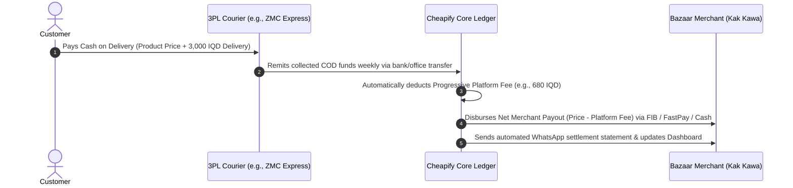

# Cheapify — Platform Fee Structure & Monetization Architecture

**Category:** Cross-Cutting Platform Specification  
**Status:** Approved Working Standard (ADR-005)  
**Target Market:** Duhok Pilot ──► Regional Hubs (Erbil, Mosul) ──► All Iraq  

---

## 1. Executive Summary & Strategic Rationale

A two-sided marketplace can only succeed in the Iraqi retail ecosystem if its monetization model protects merchant margins. 

Traditional Iraqi platforms (such as Miswag or Elryan) extract **10% to 15% commissions** per transaction or operate exclusive 1P inventories. For local bazaar merchants operating on slim **15% to 25% gross margins** across electronics, home appliances, and standardized goods, a 12% commission absorbs nearly their entire gross profit. Consequently, merchants either refuse to join or inflate their online prices to compensate, defeating the core value proposition of an affordable marketplace.

To maintain Cheapify's mission—**eliminating arbitrary price variation and empowering merchants to list their absolute lowest bazaar prices**—Cheapify deploys a **Progressive Marginal Tiering** fee model. Merchants pay an ultra-accessible, value-aligned take rate that scales fairly with order size, ensuring they remain profitable on every single sale.

---

## 2. Eliminating the "Cliff Effect" (The Mathematical Foundation)

### 2.1 What is the Cliff Effect?
In a naive step-bracket fee system, a single percentage rate is applied to the *entire* ticket price based on where it falls. For instance, if an app charges 5% on items under 15,000 IQD and 3% on items above 15,000 IQD:
* An item priced at **14,500 IQD** incurs a fee of:
  $$14,500 \times 5\% = \mathbf{725\text{ IQD}}$$
* An item priced at **16,000 IQD** incurs a fee of:
  $$16,000 \times 3\% = \mathbf{480\text{ IQD}}$$

This creates a severe **regressive cliff (notch)**: a merchant selling a *cheaper* product pays *more* money in fees than a merchant selling an *expensive* product. This creates perverse pricing incentives, confusing accounting, and merchant resentment.

### 2.2 The Solution: Progressive Marginal Tiering
To completely avoid the cliff effect, Cheapify applies **progressive marginal tiering** (analogous to modern progressive income tax brackets). 

The platform never applies a single flat percentage to the entire total. Instead, the transaction price is divided into incremental tranches, and each percentage rate applies **only to the dollar/dinar portion falling strictly within that bracket**:

```
┌────────────────────────────────────────────────────────────────────────┐
│ TIER 1: First 1 to 10,000 IQD                    ──► 5.0% Take-Rate    │
│ TIER 2: Incremental Amount from 10,001 to 100,000 IQD ──► 3.0% Take-Rate│
│ TIER 3: Incremental Amount Above 100,000 IQD     ──► 1.5% Take-Rate    │
└────────────────────────────────────────────────────────────────────────┘
```

#### Mathematical Proof of Smooth Monotonicity:
Under this formula:
* For **14,500 IQD**:
  $$\text{Fee} = (10,000 \times 5\%) + (4,500 \times 3\%) = 500 + 135 = \mathbf{635\text{ IQD}}$$
* For **16,000 IQD**:
  $$\text{Fee} = (10,000 \times 5\%) + (6,000 \times 3\%) = 500 + 180 = \mathbf{680\text{ IQD}}$$

Because $680\text{ IQD} > 635\text{ IQD}$, the fee function is **strictly monotonically increasing**:
$$\forall P_2 > P_1 \implies \text{Fee}(P_2) > \text{Fee}(P_1)$$

A higher retail price **always** yields a higher platform fee, with zero cliffs, zero notches, and mathematically continuous scaling.

---

## 3. The 3-Tier Progressive Rate Structure

The parameters are calibrated to reflect the purchasing power and margin profiles of Iraqi retail goods across all categories:

| Tier | Price Tranche (IQD) | Marginal Rate | Maximum Fee in Tier | Cumulative Max Fee at Tier Ceiling |
| :---: | :--- | :---: | :---: | :---: |
| **Tier 1** | **1 to 10,000 IQD** | **5.0%** | 500 IQD | 500 IQD |
| **Tier 2** | **10,001 to 100,000 IQD** | **3.0%** | 2,700 IQD | 3,200 IQD |
| **Tier 3** | **100,001+ IQD** | **1.5%** | No ceiling (15 IQD per 1,000 IQD) | Dynamic |

---

## 4. Multi-Category Price Point Simulation & Competitor Benchmarking

The table below illustrates how the progressive marginal fee behaves across common standardized products, contrasted against traditional marketplace commissions (12% industry baseline):

| Product Example | Retail Price (IQD) | Tier 1 Fee (5%) | Tier 2 Fee (3%) | Tier 3 Fee (1.5%) | Total Cheapify Fee | Effective Take-Rate | Miswag Benchmark (12%) | Merchant Margin Saved |
| :--- | :---: | :---: | :---: | :---: | :---: | :---: | :---: | :---: |
| **Braided Fast-Charging Cable** | **5,000** | 250 | — | — | **250 IQD** | 5.00% | 600 IQD | **+350 IQD (58% savings)** |
| **20W Fast Wall Charger** | **10,000** | 500 | — | — | **500 IQD** | 5.00% | 1,200 IQD | **+700 IQD (58% savings)** |
| **10,000mAh Power Bank** | **14,500** | 500 | 135 | — | **635 IQD** | 4.38% | 1,740 IQD | **+1,105 IQD (64% savings)** |
| **TWS Wireless Earbuds** | **16,000** | 500 | 180 | — | **680 IQD** | 4.25% | 1,920 IQD | **+1,240 IQD (65% savings)** |
| **Kitchen Hand Blender** | **25,000** | 500 | 450 | — | **950 IQD** | 3.80% | 3,000 IQD | **+2,050 IQD (68% savings)** |
| **Gaming Headset / Desk Lamp** | **45,000** | 500 | 1,050 | — | **1,550 IQD** | 3.44% | 5,400 IQD | **+3,850 IQD (71% savings)** |
| **Branded Quartz Watch / Perfume** | **85,000** | 500 | 2,250 | — | **2,750 IQD** | 3.24% | 10,200 IQD | **+7,450 IQD (73% savings)** |
| **Mechanical Keyboard / Air Fryer** | **100,000** | 500 | 2,700 | — | **3,200 IQD** | 3.20% | 12,000 IQD | **+8,800 IQD (73% savings)** |
| **24" 100Hz Gaming Monitor** | **150,000** | 500 | 2,700 | 750 | **3,950 IQD** | 2.63% | 18,000 IQD | **+14,050 IQD (78% savings)** |
| **Robot Vacuum / Tablet** | **350,000** | 500 | 2,700 | 3,750 | **6,950 IQD** | 1.99% | 42,000 IQD | **+35,050 IQD (83% savings)** |
| **Commercial POS Scale / Espresso Machine** | **600,000** | 500 | 2,700 | 7,500 | **10,700 IQD** | 1.78% | 72,000 IQD | **+61,300 IQD (85% savings)** |
| **High-End Laptop / Smart TV** | **1,200,000** | 500 | 2,700 | 16,500 | **19,700 IQD** | 1.64% | 144,000 IQD | **+124,300 IQD (86% savings)** |

### Key Economic Takeaways:
1. **Low-Ticket Alignment:** On everyday essentials (<15,000 IQD), the nominal fee is tiny (250–680 IQD), keeping transaction friction virtually non-existent.
2. **Mid-Ticket Fairness:** On high-volume lifestyle and kitchen goods (25,000–100,000 IQD), effective take rates gently glide from 3.8% down to 3.2%.
3. **High-Ticket Competitiveness:** On expensive electronics and appliances (>150,000 IQD), the marginal 1.5% rate pulls the effective fee below 2.5%, preventing high absolute deductions that would scare away authorized distributors.

---

## 5. Mathematical Formulation

Let $P$ represent the confirmed retail selling price of a product in Iraqi Dinars (IQD).  
The platform take-rate fee $F(P)$ is defined by the piecewise continuous linear function:

$$
F(P) = 
\begin{cases} 
0.05 \times P & \text{if } 0 < P \le 10,000 \\
500 + 0.03 \times (P - 10,000) & \text{if } 10,000 < P \le 100,000 \\
3,200 + 0.015 \times (P - 100,000) & \text{if } P > 100,000 
\end{cases}
$$

### Rounded Settlement Rule:
To prevent fractional dinars and facilitate smooth Cash on Delivery (COD) cash handling, the computed fee $F(P)$ is rounded to the nearest **25 IQD** (e.g., 635 IQD rounds to 625 or 650 IQD according to standard banking half-up rule).

---

## 6. Software Implementation Reference (TypeScript / Node.js)

This pure function is embedded directly into the Cheapify checkout engine and merchant settlement pipeline:

```typescript
/**
 * Calculates the Cheapify marketplace platform fee using
 * Progressive Marginal Tiering (eliminates the cliff effect).
 *
 * @param priceIQD - Product selling price in Iraqi Dinars (must be positive)
 * @returns Object containing the calculated fee and effective percentage
 */
export function calculateCheapifyFee(priceIQD: number): { feeIQD: number; effectiveRatePct: number } {
  if (priceIQD <= 0) {
    return { feeIQD: 0, effectiveRatePct: 0 };
  }

  const TIER_1_LIMIT = 10_000;
  const TIER_2_LIMIT = 100_000;

  const RATE_TIER_1 = 0.05;  // 5.0%
  const RATE_TIER_2 = 0.03;  // 3.0%
  const RATE_TIER_3 = 0.015; // 1.5%

  const MAX_FEE_TIER_1 = TIER_1_LIMIT * RATE_TIER_1; // 500 IQD
  const MAX_FEE_TIER_2 = (TIER_2_LIMIT - TIER_1_LIMIT) * RATE_TIER_2; // 2,700 IQD

  let fee = 0;

  if (priceIQD <= TIER_1_LIMIT) {
    fee = priceIQD * RATE_TIER_1;
  } else if (priceIQD <= TIER_2_LIMIT) {
    fee = MAX_FEE_TIER_1 + (priceIQD - TIER_1_LIMIT) * RATE_TIER_2;
  } else {
    fee = MAX_FEE_TIER_1 + MAX_FEE_TIER_2 + (priceIQD - TIER_2_LIMIT) * RATE_TIER_3;
  }

  // Round to nearest integer IQD
  const finalFeeIQD = Math.round(fee);
  const effectiveRatePct = Number(((finalFeeIQD / priceIQD) * 100).toFixed(2));

  return {
    feeIQD: finalFeeIQD,
    effectiveRatePct,
  };
}
```

---

## 7. Cash Settlement & Courier Reconciliation Workflow

In Iraq, where **85%+ of e-commerce volume relies on Cash on Delivery (COD)**, platform fees cannot be collected via merchant credit cards. Instead, Cheapify operates an automated net-settlement mechanism via our 3PL courier partnership:



### Advantages of Automated Net Reconciliation:
1. **Zero Merchant Invoicing Friction:** Merchants never receive an overdue bill or pay out of pocket; fees are deducted at source from gross collected COD balances.
2. **Transparent Dashboard Visibility:** The merchant's dashboard displays the exact gross price, Cheapify fee, courier fee, and net balance credited for every order ID.
3. **Weekly Liquidity:** Guaranteed weekly payout disbursements give bazaar retailers reliable cash flow to restock inventory quickly.

---

## 8. Cross-Document References

* **Foundational Problem & Value:** [`../entrepreneurship/01_problem_solution_value.md`](../entrepreneurship/01_problem_solution_value.md)
* **Market Opportunity & Sizing:** [`../entrepreneurship/02_market_opportunity_and_sizing.md`](../entrepreneurship/02_market_opportunity_and_sizing.md)
* **Customer & Merchant Personas:** [`../entrepreneurship/03_customer_and_merchant_personas.md`](../entrepreneurship/03_customer_and_merchant_personas.md)
* **Architectural Decisions Log:** [`../agent/decisions.md`](../agent/decisions.md) (ADR-005)

